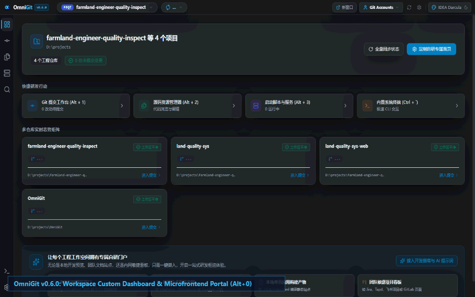
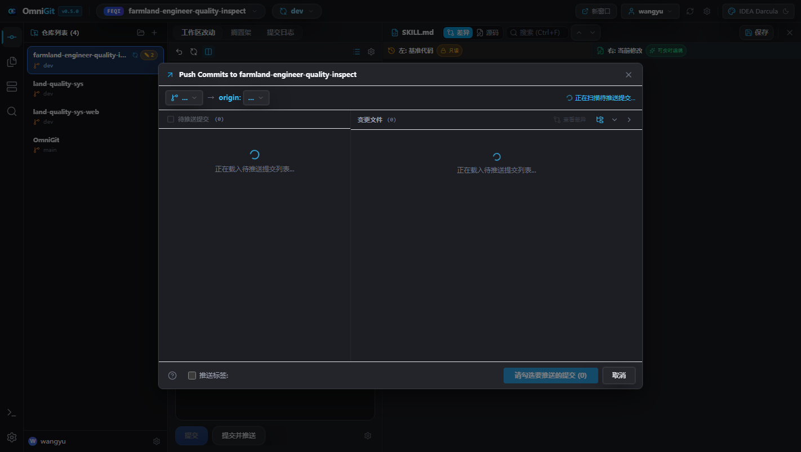
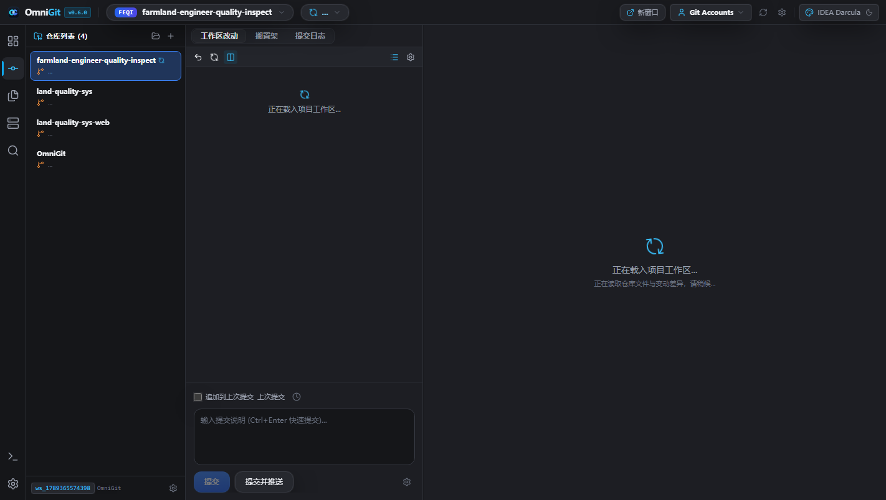
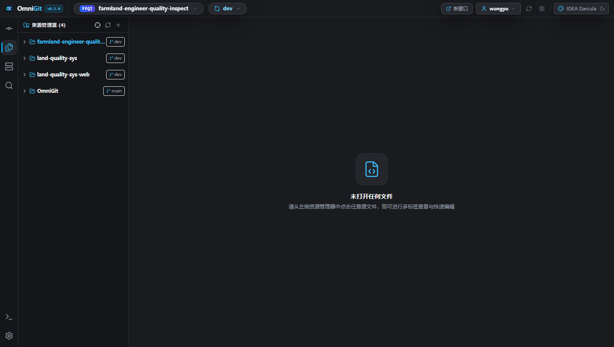
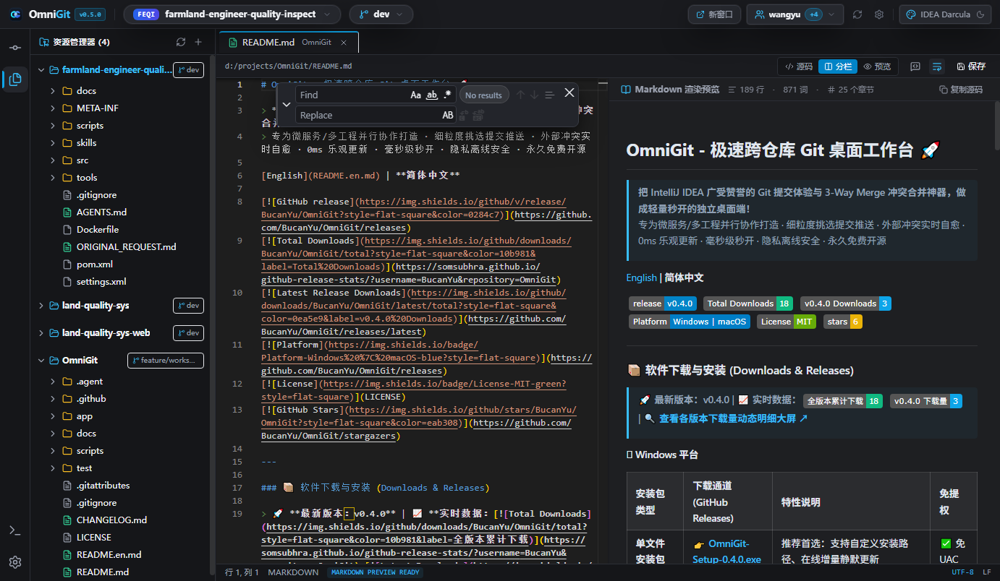
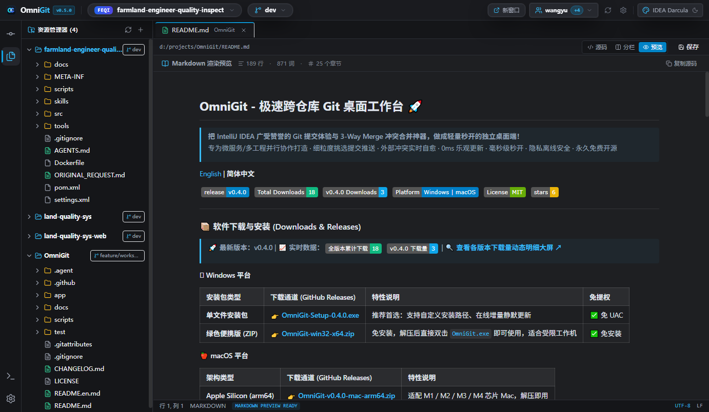
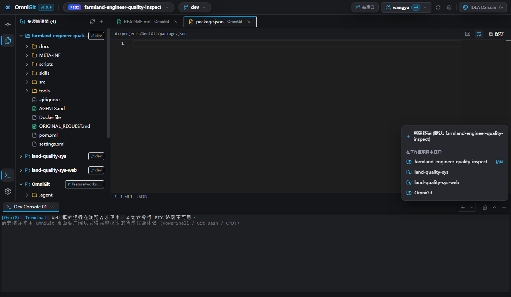
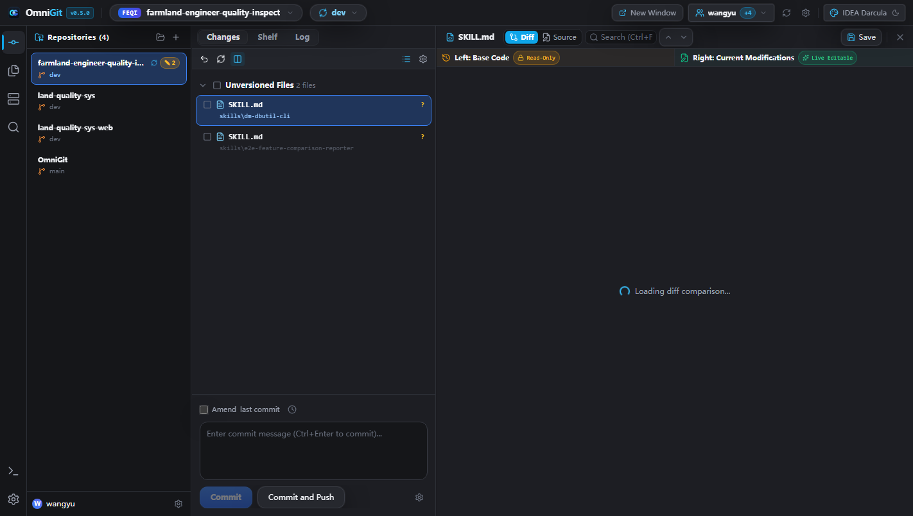
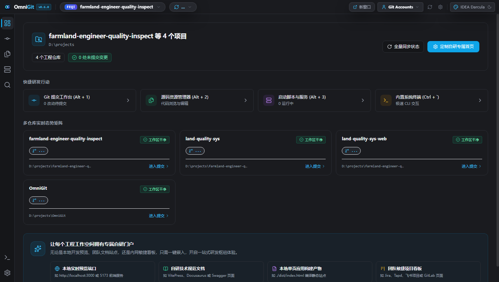
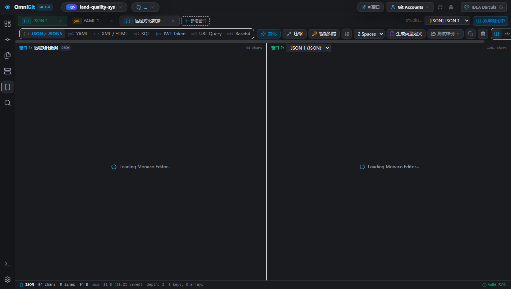

# OmniGit - High-Performance Multi-Repo Git Workbench & Local Microservices Platform 🚀

> **Centered around the beloved IntelliJ IDEA Git workflow & 3-Way Merge conflict resolver, seamlessly integrating multi-root workspace exploration, Monaco code editing, live draggable Markdown preview, VS Code-aligned terminal dock, unified microservice launch orchestration, custom workspace developer portal, and a 10-in-1 offline data formatting workbench for modern developers.**  
> 
> Built for multi-repo & microservices collaboration · Multi-repo batch pull/checkout · Fine-grained selective push · Real-time external conflict auto-healing · 1-Click microservices start/stop & port conflict release · 10-in-1 offline data formatter & split compare · 0ms Optimistic UI · Offline privacy-first · 100% Free & Open-Source

**English** | [简体中文](README.md)

[](https://github.com/BucanYu/OmniGit/releases)
[](https://somsubhra.github.io/github-release-stats/?username=BucanYu&repository=OmniGit)
[](https://github.com/BucanYu/OmniGit/releases/latest)
[](https://github.com/BucanYu/OmniGit/releases)
[](LICENSE)
[](https://github.com/BucanYu/OmniGit/stargazers)

---

### 📦 Downloads & Releases

> 🚀 **Latest Release: v0.6.0** | 📈 **Live Stats: [](https://somsubhra.github.io/github-release-stats/?username=BucanYu&repository=OmniGit) [](https://github.com/BucanYu/OmniGit/releases/latest)** | 🔍 **[View Live Download Analytics Dashboard ↗](https://somsubhra.github.io/github-release-stats/?username=BucanYu&repository=OmniGit)**

#### 🪟 Windows
| Package Format | Download Link (GitHub Releases) | Highlights | Zero UAC |
| :--- | :--- | :--- | :---: |
| **Setup Installer** | 👉 **[OmniGit-Setup-0.6.0.exe](https://github.com/BucanYu/OmniGit/releases/latest)** | Recommended: high compression (76MB), customizable path, auto-updates | ✅ Zero UAC |
| **Portable (ZIP)** | 👉 **[OmniGit-win32-x64.zip](https://github.com/BucanYu/OmniGit/releases/latest)** | Extract & run `OmniGit.exe` directly, suitable for restricted work PCs | ✅ Portable |

#### 🍎 macOS
| Architecture | Download Link (GitHub Releases) | Highlights |
| :--- | :--- | :--- |
| **Apple Silicon (arm64)** | 👉 **[OmniGit-v0.6.0-mac-arm64.zip](https://github.com/BucanYu/OmniGit/releases/latest)** | Native build for Apple Silicon M1 / M2 / M3 / M4 Macs |
| **Intel (x64)** | 👉 **[OmniGit-v0.6.0-mac-x64.zip](https://github.com/BucanYu/OmniGit/releases/latest)** | Compatible with Intel-based Macs |

> 💡 **Release History & Analytics**:  
> - Looking for previous versions (v0.5.0, v0.4.0, v0.3.0, etc.) and changelogs? Visit 👉 **[GitHub Releases Archive](https://github.com/BucanYu/OmniGit/releases)**  
> - Want to monitor real-time daily download trends and breakdown charts? Visit 👉 **[GitHub Release Stats Dashboard](https://somsubhra.github.io/github-release-stats/?username=BucanYu&repository=OmniGit)**

---

## 🎬 Live Walkthrough Animation

> The animated demo below showcases the complete workflow of OmniGit: from **Git Core Workbench and 3-Way Merge conflict resolution**, **Zero-Checkout selective push**, to **multi-root project exploration, Monaco code editing**, **draggable split Markdown live preview**, **VS Code-aligned terminal dock**, and the **Services & Launch Scripts Manager with real-time ANSI logs**.



---

## 💡 Why OmniGit?

With modern software architecture evolving into microservices and monorepos, developers (especially those working in VS Code, Cursor, Sublime, or terminal environments) face these recurring pain points:

1. **Resolving Merge Conflicts is Stressful**: Manually hunting down `<<<<<<< HEAD` markers in standard editors is error-prone, carrying the constant risk of corrupting remote branches or breaking CI pipelines;
2. **Full IDEs Are Too Heavy**: IntelliJ IDEA and WebStorm offer the gold standard for visual conflict resolution, but consume 2–4 GB of RAM and take 30 seconds to boot. Opening a heavy IDE just to resolve one Git conflict heats up your machine;
3. **Inflexible Commit & Push Controls**: In agile sprints, urgent bug fixes often interleave with unverified feature commits. Traditional clients force you to push all commits or perform tedious manual branch checkouts and cherry-picks;
4. **Desync with External Editors**: When you resolve conflicts in your favorite editor and save, most Git clients remain stuck on the conflict screen until you manually execute `git add`;
5. **Painful Multi-Service Launching**: Monorepo or microservice setups require launching multiple backends, frontends, and auxiliary workers, leaving developers with 6–8 terminal windows scattered across the screen and lingering orphan processes;
6. **Context Switching Friction**: Inspecting a couple of source files, launching a dev server, or running a quick Git command usually forces you to open heavy external editors or separate terminal windows;
7. **Flaws of Existing Standalone Clients**:
   - **SourceTree**: Clunky, slow, prone to freezing on Windows, and mandates an Atlassian login;
   - **GitKraken**: Commercialized; paywalls private repos and merge conflict resolution behind monthly subscriptions;
   - **Fork**: Proprietary closed-source software that costs $49.99.

**OmniGit ends these compromises.** It packages JetBrains' ergonomic Git workflow and visual 3-Way Merge as its centerpiece, while deeply integrating **multi-root workspace exploration, Monaco code editing, draggable Markdown live preview, a VS Code-aligned terminal dock, and a unified microservice launch orchestrator**—all starting in **1 second, using ~60MB of RAM, seamlessly functional on both Desktop and Web, and 100% free and open-source.**

---

## ✨ Killer Features

### 1. 🎯 JetBrains-Grade 3-Way Merge Conflict Resolver (Core Git Engine)


- **Intuitive 3-Column View**: Left: Local changes (Yours) · Center: Merged result · Right: Incoming changes (Theirs);
- **1-Click Bidirectional Merging**: Click arrows to cleanly accept or discard changes with live result synthesis;
- **Safety Barrier Against Raw Markers**: Blocks commits if any file still contains unmerged `<<<<<<<` markers;
- **External Resolution Auto-Healing**: When conflict markers are removed and saved in external editors (VS Code, Sublime), OmniGit automatically stages changes and clears the conflict state in real-time;
- **Full Chinese & Unicode Path Encoding**: Fully handles non-ASCII characters via `-c core.quotepath=false` and automatic octal de-escaping.

---

### 2. 🚀 Zero-Checkout Selective Push & Multi-Repo Batch Collaboration


- **Zero-Checkout Branch Selection**:
  - Switch source and remote target branches directly inside the push modal without physically checking out local workspaces;
- **Commit Multi-Select Checkboxes**:
  - Independent checkboxes for outgoing commits; push selected commits directly to the remote branch or create a dedicated patch branch (e.g., `patch/fix-xxx`) for PR / Code Review without polluting your current working tree;
- **Push Up To Here**:
  - Right-click any commit card to push history up to that point, isolating subsequent unverified commits;
- **Cross-Branch Cherry-pick & Sync**:
  - In Commit Log, right-click any commit to cleanly cherry-pick and sync to other branches (such as `test` or `uat`) with optional automatic remote pushing;
- **Multi-Repo Batch Operations (Batch Pull / Fetch / Checkout)**:
  - Concurrently execute **Batch Pull**, **Batch Fetch**, and **Batch Checkout** across all repositories in your workspace from the sidebar header with real-time per-repo status feedback;
- **Git Stash Shelf Manager & SVG Commit Branch Graph**:
  - Built-in `StatusStashDrawer` to stash local changes (with optional untracked files and message), inspect stashes, Apply, Pop, and Drop;
  - Real-time multi-parent SVG branch evolution and merge graph (`CommitGraphLane`) in the Commit Log.

---

### 3. 🛠️ Services & Launch Scripts Manager (Unified Microservice Orchestrator)


- **Script-Centric Workflow & In-Module Project Switcher**:
  - Automatically discovers scripts across all workspace projects (`package.json` scripts, `.bat`, `.sh`, etc.), with support for custom launch scripts, stop scripts, and environment variables;
  - Built-in **In-Module Project Switcher** in the top-left header to switch projects directly and sync active Git repository state;
- **Port Conflict Detection & 1-Click Port Release**:
  - Configure service ports and automatically sniff `EADDRINUSE` port collision errors from live logs;
  - Displays a prominent port conflict alert with a **1-Click Release Port & Restart** button that safely terminates the occupying PID tree and restarts the service;
- **Sequential Start Delay & Drag-to-Reorder (`startDelayMs`)**:
  - Reorder service cards via drag-and-drop and configure per-service startup delays (`startDelayMs`) for ordered dependency orchestration;
- **Real-Time ANSI Color Streaming Console & Keyword Filter**:
  - High-performance SSE console with `32ms` chunk batching, 350-line sliding window rendering, native ANSI color rendering, and real-time keyword log filtering;
  - **Manual Scroll Priority Lock**: Sticks to bottom by default, and immediately locks viewport when the user scrolls up via mouse wheel so continuous log output never interrupts inspection;
- **One-Shot Task Script Auto-Completion & Orphan Process Guard**:
  - Automatically bypasses blocking Windows `pause` commands and distinguishes long-running services from one-shot task scripts (marking exit code `0` as `Completed`);
  - Asynchronous process lifecycle management and cascade process-tree termination prevent UI freezes and orphan processes.

---

### 4. 📂 Multi-Root Workspace Explorer


- **Cross-Repo Single Window**: Designed for microservices, front-and-backend pairs, and monorepos. Browse, expand, and drill down through multiple repository file trees concurrently in a single pane;
- **Unbound from Git Hard Exclusion (Full Workspace Visibility)**:
  - Shows all workspace files and folders by default—including `.env*`, `dist`, `build`, `target`, and `node_modules` (skipping only `.git` / `.svn` / `.hg` metadata directories);
  - Styles `.gitignore`-matched entries with muted opacity and provides a top-bar **Show All Files / Hide Git Ignored Files** toggle plus **Collapse All Folders**;
- **Safe Binary & Large File Metadata Card (`BinaryOrLargeFileNotice`)**:
  - Selecting images, archives, binaries, or files larger than 2MB displays a clean metadata card with 1-click actions to **Open with Default System App** or **Reveal in OS File Explorer**;
- **Tab Deduplication with Single-Flight Lock**: Eliminates duplicate tab bugs by auto-focusing existing tabs when clicking already open files.

---

### 5. 💻 Monaco Code Editor & Smart Tabs


- **Sub-50ms Offline Load**: Powered by the same Monaco Editor engine as VS Code, fully bundled locally with syntax highlighting and line numbers for all major languages;
- **Inline Git Blame**: Toggle line-by-line Git Blame annotations directly in the editor header to inspect commit hashes, authors, relative timestamps, and commit summaries;
- **Smart Tab Disambiguation**: When identical file names are open across different projects (e.g. multiple `package.json` files), the tab strip automatically appends parent directory labels;
- **Horizontal Wheel Scroll & Tab Overflow Drawer**: Smooth mouse wheel scrolling along tab strips with an overflow dropdown menu for instant navigation;
- **Smart Comment Toggle (<kbd>Ctrl + /</kbd>)**: Toggle single-line and block comments instantly across source code, HTML, and Markdown;
- **Floating Find & Replace (<kbd>Ctrl + F</kbd>)**:
  - Sleek floating card widget styled with Darcula and VS Code aesthetics;
  - Full support for Match Case (`Aa`), Whole Word (`Ab`), and Regular Expressions (`.*`);
  - Real-time match counter (`1/N`) with smooth previous/next result navigation.

---

### 6. 📝 Draggable Split Markdown Live Preview


- **GitHub-Fidelity Rendering**: Supports Markdown headings, tables, syntax-highlighted code blocks, task lists, and GitHub badges;
- **Local Relative Image Resolution**: Built-in `/api/fs/raw` asset pipeline displays local relative images (e.g., `./docs/images/xxx.png`) with 100% fidelity;
- **Free Split Border Dragging**: Smoothly drag the middle separator to adjust editor vs. preview width with persistent ratio memory;
- **Double-Click Center Reset**: Double-click the separator at any time to instantly snap back to the 50:50 ratio;
- **1-Click Fullscreen Reading**: Quickly toggle between Source, Split, and Fullscreen reading modes.

---

### 7. 🖥️ VS Code-Aligned Integrated Terminal Dock


- **Multi-Tab Concurrent PTY Sessions**: Run PowerShell, Git Bash, CMD, and WSL concurrently;
- **Double-Click Tab Renaming**: Rename terminal sessions on the fly (e.g., `Backend Dev`, `Vite Watcher`);
- **Aligned with VS Code Controls**:
  - <kbd>—</kbd> (Minus): Minimize/collapse drawer;
  - <kbd>🗑️</kbd> (Trash): Terminate process and close tab;
  - <kbd>^</kbd> / <kbd>v</kbd>: Maximize and restore dock height;
- **Smart Upward Popup Menu**: Add Terminal menu automatically pops upwards to prevent taskbar cutoff.

---

### 8. ⚡ 1-Click "Undo Merge" Safe Rollback
- Made an accidental `git merge dev` and want to back out cleanly?
- OmniGit provides a dedicated **Undo Merge** button in the branch menu, sniffing recent merge commits and safely restoring your working tree with a high-risk confirmation guard.

---

### 9. 🌐 Desktop & Web Parity, Bilingual Localization & Offline Privacy


- **Full Desktop + Web Parity**: Run as a standalone Electron desktop client or access via any browser on your local network with identical features and real-time streaming;
- **Strict Bilingual Support**: English and Chinese locales are maintained with zero translation mixing;
- **Classic Themes**: Built-in Darcula, IDEA Light, and Nord Frost themes;
- **0ms Instant Hydration & Anti-Freeze Guardrails**: L1 memory, L2 LocalStorage, and L3 disk snapshots combined with Git process concurrency semaphores and universal build-artifact watcher cooldowns eliminate loading flashes and compilation freezes;
- **100% Offline Sandbox**: **Never uploads your code or credentials**.

---

### 10. 🌐 Workspace Custom Developer Portal & Microfrontend Host (Workspace Dashboard)


- **Shortcut <kbd>Alt + 0</kbd> Instant Access**:
  - Default Health Hub: Aggregates multi-repo branch pills, uncommitted diff counts, pending push/pull badges, and microservice statuses;
  - View Keep-Alive: Switch seamlessly between Git workbench, Monaco editor, and custom portal without losing iframe state or triggering reloads;
- **4 Out-of-the-Box Core Scenarios**:
  - **Local Dev Live Preview**: Embed active Next.js / Vite / Vue CLI dev servers (e.g. `http://localhost:3000` or `5173`) with full HMR;
  - **Tech Specs & API Docs**: Integrate VitePress, Docusaurus, Swagger UI, or Storybook right alongside code editing;
  - **Static SPA Build Mount**: Mount local `./dist/index.html` static builds directly without extra web servers; includes automatic `<base>` tag injection to eliminate 404 blank screens;
  - **Team Agile Project Board**: Seamlessly embed Jira, TAPD, Feishu Project, or GitLab Issues;
- **Zero-Trust Controlled Bi-directional Bridge (`OmniGitBridge`)**:
  - Safe postMessage handshake with single-use session tokens, strictly blocking command injection and RCE vulnerabilities;
  - Navigate directly to OmniGit views (`git`, `explorer`, `services`) with automatic target repo activation;
  - Open source files in the built-in Monaco editor with path traversal protection;
  - Synchronize dark and light themes dynamically in real time;
- **Team-Wide Shared Config (`.omnigit/dashboard.json`)**:
  - Commit the configuration to Git so all team members automatically share the same workspace portal upon `git pull`;
- **Comprehensive Developer Guide & AI Prompt**:
  - See the full specification, minimal SDK, and AI prompt template in 👉 **[Custom Workspace Portal & OmniGitBridge Interaction Guide](docs/CUSTOM_DASHBOARD_GUIDE.md)**.

---

### 11. 🧰 10-in-1 Offline Data Formatter & Inspector Workbench (Data Tools)


- **Shortcut <kbd>Alt + 4</kbd> Instant Access, 100% Offline & Privacy-Safe**:
  - Format sensitive production JSON payloads, JWT tokens, and SQL queries locally in milliseconds without ever pasting proprietary data into third-party web tools;
- **10 High-Frequency Formats & Developer Utilities Built In**:
  - **JSON / JSON5**: Beautify, minify, **Smart Syntax Auto-Fix** (repairs single quotes, trailing commas, unquoted keys, and comments), recursive alphabetical key sorting, and **1-Click TypeScript `interface` generation**;
  - **YAML / XML / HTML / SQL**: 2/4-space indentation formatting, minification, and live structural tree mapping for YAML and XML;
  - **JWT Token / URL Query / Base64**: Offline JWT Header & Payload inspection (with automatic `exp`/`iat` timestamp decoding and expiration badges), URL query parameter table breakdown, and UTF-8 safe Base64 encoding/decoding;
  - **Timestamp Converter / UUID & Hash / Regex Tester**: Bi-directional Unix timestamp (s/ms) and timezone conversion, bulk UUID v4 & MD5/SHA1/SHA256/SHA512 hash calculation, and real-time regular expression matching with capture group inspection;
- **IDE-Grade Multi-Window Tabs & Side-by-Side Split Comparison**:
  - Click `+ New Window` to open multiple tabs with a dedicated format selector dropdown, double-click tab renaming, and automatic cross-session persistence;
  - Toggle **Side-by-Side Split Compare Mode** to compare two JSON / YAML / SQL tabs concurrently on the same screen;
- **4 Interactive View Modes (`Split` / `Editor` / `Tree` / `Table`)**:
  - Seamlessly switch between Split Editor + Tree, Editor-only, collapsible Tree Inspector (with search filter and 1-click JSONPath / value copy), and 2D Table View.

---

## 📊 Comparison with Popular Tools

| Dimension | **OmniGit** | SourceTree | GitKraken | Fork | Native VS Code |
| :--- | :---: | :---: | :---: | :---: | :---: |
| **Scope** | **Git Core + Multi-Repo Microservice Portal** | Traditional Git client | Traditional Git client | Traditional Git client | General text editor |
| **License** | **100% Free & Open-Source (MIT)** | Proprietary freeware | Freemium / Paid subscription | $49.99 Commercial | Free & open-source |
| **3-Way Merge Conflict Resolver** | **Native 3-column visual merge** | Requires external tool | Paywalled | Native | Complex extensions needed |
| **External Conflict Auto-Healing** | **Auto-detects and stages on external save** | Manual staging required | Manual refresh required | Manual staging required | Manual staging required |
| **Multi-Repo Batch Ops & Branch Graph** | **Native (Batch Pull/Fetch/Checkout, Graph, Stash, Blame)** | Manual per-repo | Multi-repo paywalled | Manual per-repo | Extensions required |
| **Multi-Service Launch & Port Release** | **Native built-in (scripts, delay, 1-click port kill)** | None | None | None | Needs tasks/plugins |
| **Selective Push & Patch Branches** | **Native support (multi-select, patch branches)** | Whole branch only | Complex | Basic | Whole branch only |
| **Multi-Root Explorer & Monaco Editor**| **Native built-in (all files, disambiguation, split preview)** | None | None | None | Native built-in |
| **Custom Workspace Portal (Microfrontend)** | **Native (`Alt+0` Health Hub + `OmniGitBridge`)** | None | None | None | Custom extension required |
| **Offline Data Tools (JSON/YAML/JWT/Regex)** | **Native (`Alt+4` 10-in-1 tools & multi-window compare)** | None | None | None | Multiple extensions needed |
| **Integrated Terminal Dock** | **Native built-in (VS Code ergonomics)** | External terminal only | Built-in | External terminal only | Native built-in |
| **1-Click Undo Merge** | **Native (with history sniffing)** | CLI commands required | Complex tree undo | Manual rollback | None |
| **Cross-Branch Commit Sync** | **Right-click Cherry-pick & push** | Manual branch checkouts | Clunky | Supported | Manual CLI required |
| **Startup & Footprint** | **Instant / ~76MB Installer** | Heavy, freezes on Windows | Heavy (> 200MB) | Native lightweight | Runs full editor runtime |
| **Account Mandatory** | **Zero login required** | Mandates Atlassian login | Mandates account signup | No login | No login |

---

## ⌨️ Efficient Keyboard Shortcuts

| Shortcut | Context | Action |
| :--- | :--- | :--- |
| <kbd>Alt + 0</kbd> | Global | Switch to **Workspace Dashboard & Custom Portal** view |
| <kbd>Alt + 1</kbd> | Global | Switch to **Git Core Workbench** view |
| <kbd>Alt + 2</kbd> | Global | Switch to **Workspace Explorer & Editor** view |
| <kbd>Alt + 3</kbd> | Global | Switch to **Microservices Orchestrator** view |
| <kbd>Alt + 4</kbd> | Global | Switch to **Data Formatter & Offline Developer Tools** view |
| <kbd>Ctrl + K</kbd> | Git View | Focus commit message box |
| <kbd>Ctrl + Shift + K</kbd> | Git View | Open Selective Push modal |
| <kbd>Ctrl + Enter</kbd> | Commit Box | Commit selected changes |
| <kbd>Ctrl + F</kbd> | Monaco Editor | Toggle modern floating find & replace widget |
| <kbd>Ctrl + /</kbd> | Monaco Editor | Toggle line or block comments |
| <kbd>Ctrl + Shift + F</kbd> | Global | Open global search across all workspace files |
| <kbd>Ctrl + `</kbd> | Global | Toggle bottom integrated terminal dock |
| <kbd>Ctrl + Shift + `</kbd> | Global | Create a new terminal session in the dock |
| <kbd>Ctrl + ,</kbd> | Global | Open System Settings modal |

---

## 🛠️ Developer Guide (Local Development)

All utility scripts are organized in the [`scripts/`](scripts/) directory (see [`scripts/README.en.md`](scripts/README.en.md)):

### 1. Launch Desktop Preview
```bash
# Option 1: Double-click scripts/start_desktop.bat
# Option 2: Command line
cd app
npm run electron:preview
```

### 2. Launch Web Development Server (HMR)
```bash
# Option 1: Double-click scripts/start_dev.bat (opens http://localhost:5345)
# Option 2: Command line
cd app
npm run dev
```

### 3. Build Windows Installer Package
Double-click: 👉 **[`scripts/build_desktop.bat`](scripts/build_desktop.bat)**.  
The build pipeline validates TypeScript types, compiles assets, injects icons, and produces a highly compressed NSIS single-file installer in `app/release/` (~76MB).

### 4. Automated Regression Test Suite
```bash
# Option 1: Run the complete 7-phase API SLA & headless Chrome CDP E2E suite
node test/scripts/run-all-tests.cjs

# Option 2: Run targeted E2E verification scripts
node --experimental-websocket test/scripts/test-workspace-explorer-e2e.cjs
node --experimental-websocket test/scripts/test-data-tools-multi-window-e2e.cjs
node --experimental-websocket test/scripts/test-services-lifecycle-e2e.cjs
```

---

## 📂 Project Architecture Overview

```text
OmniGit/
├── app/                              # Core application
│   ├── electron/                     # Electron main process & auto-updater
│   │   ├── main.ts                   # Window lifecycle, private local server & detection
│   │   ├── preload.ts                # Secure preload script (IPC bridge)
│   │   ├── serviceProcessManager.ts  # Desktop service lifecycle, port checks & tree cleanup
│   │   └── updater.ts                # Silent updater via GitHub Releases
│   ├── src/                          # Frontend source (React 18 + Zustand + Tailwind)
│   │   ├── components/               # Base UI components (Modal, Button, ResizeDivider, Toast)
│   │   ├── features/                 # Modular feature domains (strict <= 800-line limit)
│   │   │   ├── activity-bar/         # Left Activity Bar (Dashboard, Git, Explorer, Services, DataTools)
│   │   │   ├── code-editor/          # Monaco editor, inline Git Blame, binary notice & Markdown preview
│   │   │   ├── data-tools/           # 10-in-1 offline formatter, tree inspector & split compare
│   │   │   ├── diff-editor/          # Monaco diff viewer & subcomponents
│   │   │   ├── git-conflict/         # Visual 3-Way Merge conflict resolver & subcomponents
│   │   │   ├── git-log/              # Commit log, SVG CommitGraphLane & cross-branch sync
│   │   │   ├── git-push/             # Branch selector, commit checkboxes & selective push
│   │   │   ├── git-status/           # Changes, StatusStashDrawer (Git Stash) & commit box
│   │   │   ├── global-search/        # Cross-project global code search modal
│   │   │   ├── navigation/           # Top branch menu, flyout submenu, undo merge, user profile
│   │   │   ├── services/             # Services orchestrator, port conflict killer & ANSI streaming
│   │   │   ├── settings/             # System settings, Git accounts, themes & about tab
│   │   │   ├── terminal/             # VS Code-styled terminal dock (PTY sessions)
│   │   │   ├── workspace/            # Multi-repo sidebar (Batch Pull/Fetch/Checkout) & welcome screen
│   │   │   ├── workspace-dashboard/  # Custom workspace portal (OmniGitBridge) & health hub
│   │   │   └── workspace-explorer/   # Full-workspace file tree, ignored toggle & directory drill-down
│   │   ├── locales/                  # Strictly isolated i18n dictionaries (zh-CN / en-US)
│   │   ├── server/                   # Local execution engine & API
│   │   │   ├── git/                  # 7 Git domain modules (Exec/Status/Log/Branch/Merge/Clone/BatchStashBlame)
│   │   │   ├── gitService.ts         # Git facade module
│   │   │   ├── fileSystemService.ts  # File tree traversal & non-destructive .gitignore tagging
│   │   │   ├── codeSearchService.ts  # High-performance cross-repo code search engine
│   │   │   ├── ignorePatterns.ts     # Universal multi-language build artifact & binary ignore dictionary
│   │   │   ├── dashboardServeHandler.ts # Static SPA portal host & automatic <base> injector
│   │   │   └── nodeServiceProcessManager.ts # Web service runner, async port probe & SSE log streaming
│   │   └── store/                    # State management (useAppStore, 9 domain slices, L1/L2/L3 cache)
│   ├── electron-builder.yml          # NSIS installer configuration
│   └── package.json                  # Dependencies & scripts
├── docs/                             # Architecture, PRD, portal dev guide & media assets
│   ├── images/                       # High-res feature showcases & demo animations (01~25)
│   ├── CUSTOM_DASHBOARD_GUIDE.md     # Custom workspace portal & OmniGitBridge developer guide
│   ├── implementation_0.6.0_plan.md  # v0.6.0 architectural implementation plan
│   └── OmniGit_PRD.md                # Product requirements & architecture documentation
├── scripts/                          # Developer automation scripts
├── test/                             # Automated E2E and benchmark test suite
└── README.md                         # Main documentation (Simplified Chinese)
```

---

## 🤝 Contributing & Feedback

Contributions, feature suggestions, and bug reports are warmly welcome!
- Found a bug or have an idea? Open an [Issue](https://github.com/BucanYu/OmniGit/issues)
- Enjoying OmniGit? Give us a ⭐️ **Star** on GitHub to support the project!

---

## 📄 License

This project is licensed under the [MIT License](LICENSE).
