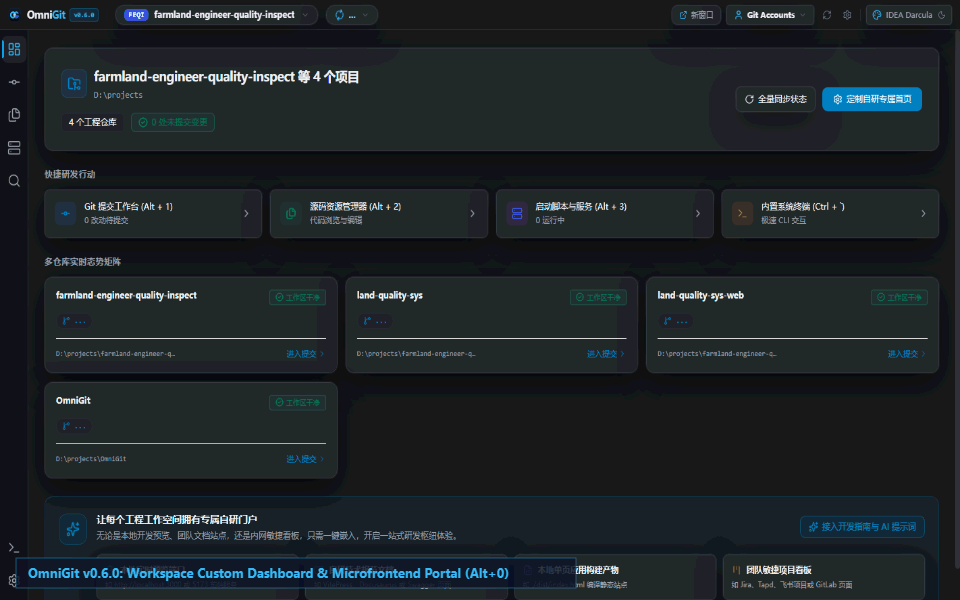
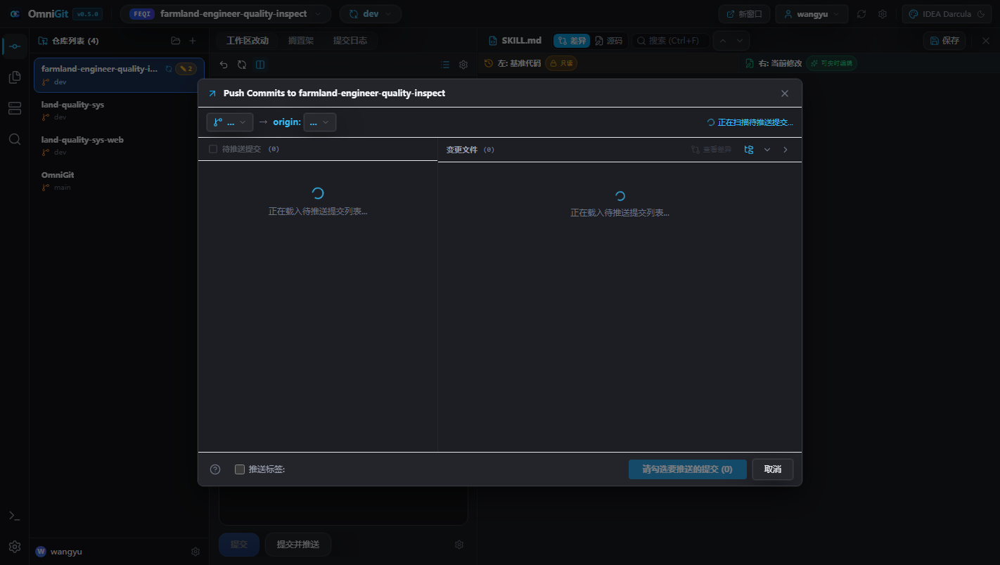
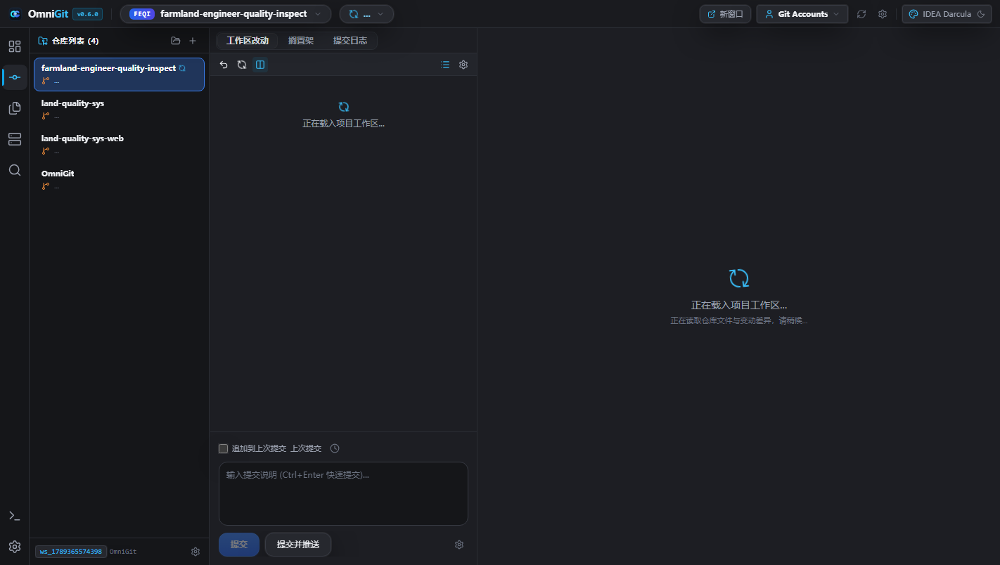
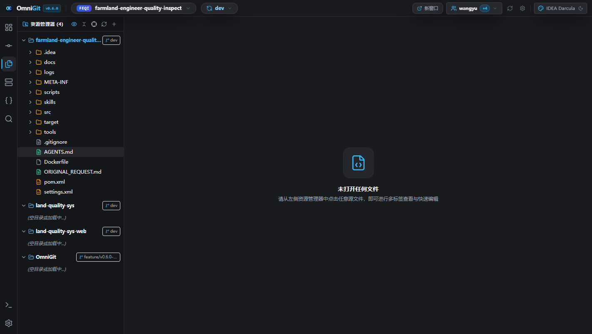
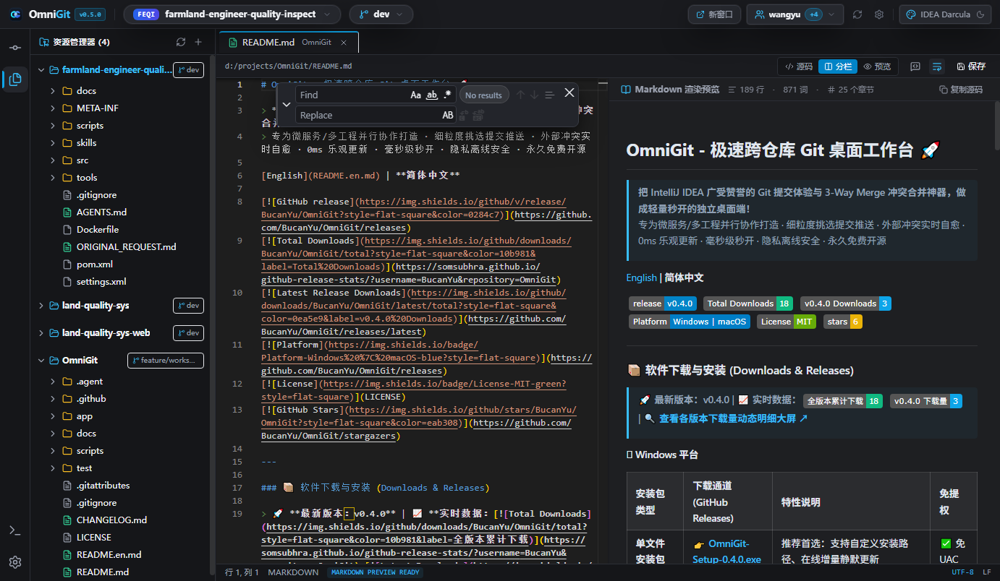
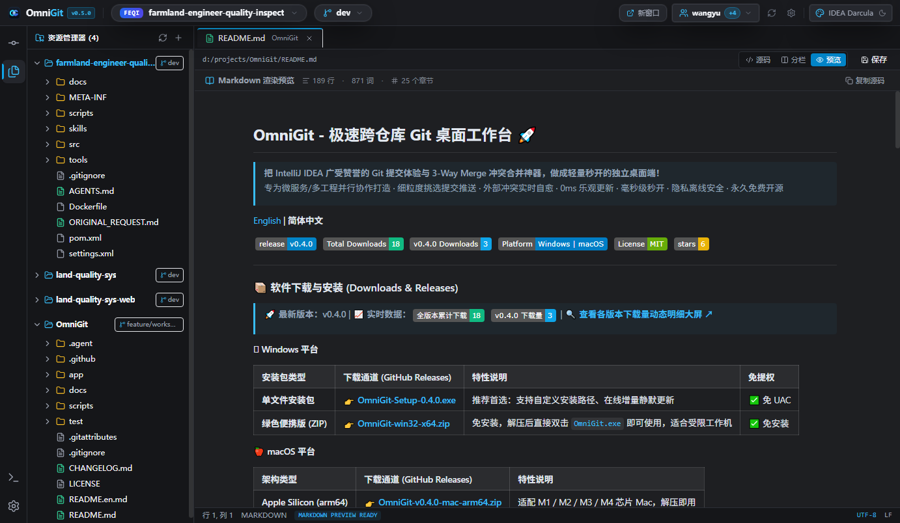
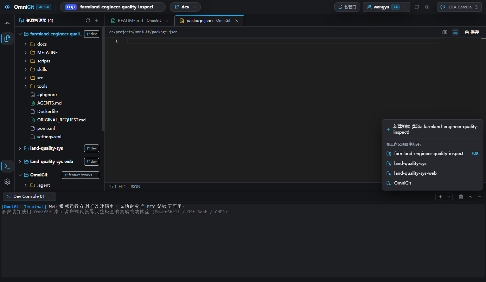
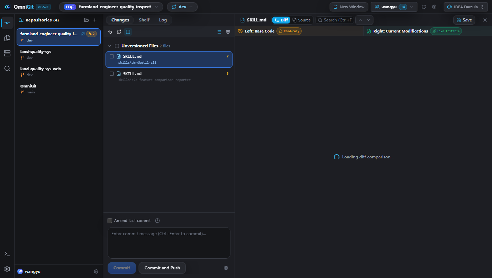
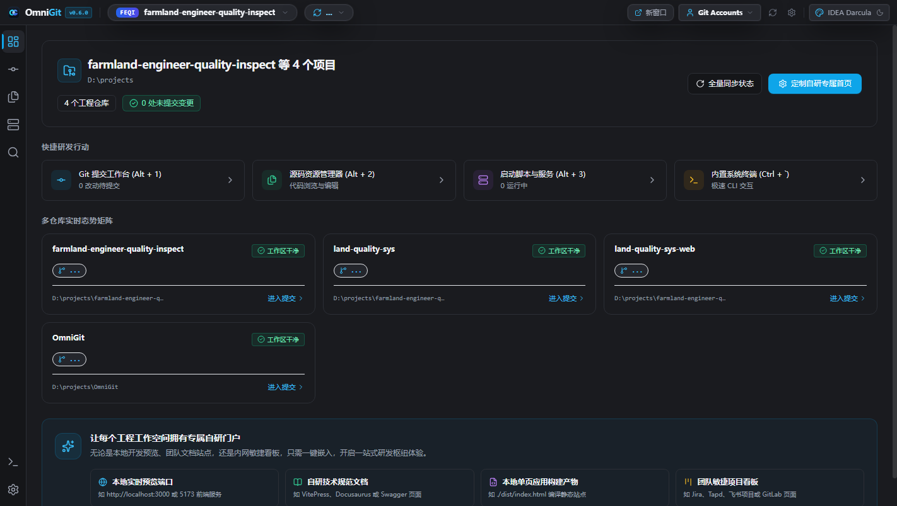
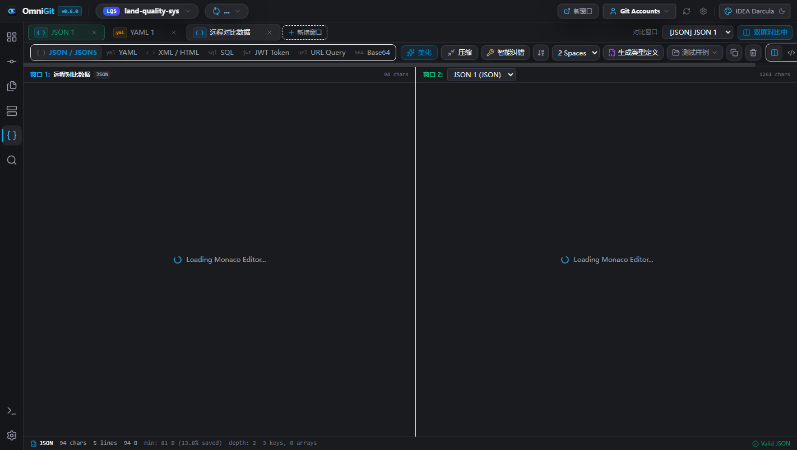

# OmniGit - 极速多工程 Git 协作与本地微服务开发工作台 🚀

> **以 IntelliJ IDEA 广受赞誉的 Git 提交体验与 3-Way Merge 冲突合并为核心，深度融合多工程源码资源管理、Monaco 代码编辑、Markdown 实时渲染、VS Code 级终端 Dock、多微服务启动编排管理、工作空间自研研发门户以及全离线多格式开发工具箱，专为现代开发者打造的超轻量秒开一体化工作台！**  
> 
> 专为微服务/多工程并行协作打造 · 多仓库批量拉取/切分支 · 细粒度挑选提交推送 · 外部冲突实时自愈 · 多微服务一键启停与端口冲突秒释 · 10 合 1 离线数据格式化与多窗对比 · 0ms 乐观水合 · 隐私离线安全 · 永久免费开源

[English](README.en.md) | **简体中文**

[](https://github.com/BucanYu/OmniGit/releases)
[](https://somsubhra.github.io/github-release-stats/?username=BucanYu&repository=OmniGit)
[](https://github.com/BucanYu/OmniGit/releases/latest)
[](https://github.com/BucanYu/OmniGit/releases)
[](LICENSE)
[](https://github.com/BucanYu/OmniGit/stargazers)

---

### 📦 软件下载与安装 (Downloads & Releases)

> 🚀 **最新正式版：v0.6.0** | 📈 **实时数据：[](https://somsubhra.github.io/github-release-stats/?username=BucanYu&repository=OmniGit) [](https://github.com/BucanYu/OmniGit/releases/latest)** | 🔍 **[查看各版本下载量动态明细大屏 ↗](https://somsubhra.github.io/github-release-stats/?username=BucanYu&repository=OmniGit)**

#### 🪟 Windows 平台
| 安装包类型 | 下载通道 (GitHub Releases) | 特性说明 | 免提权 |
| :--- | :--- | :--- | :---: |
| **单文件安装包** | 👉 **[OmniGit-Setup-0.6.0.exe](https://github.com/BucanYu/OmniGit/releases/latest)** | 推荐首选：超高压缩比 (仅 76MB)，支持自定义路径与在线增量静默更新 | ✅ 免 UAC |
| **绿色便携版 (ZIP)** | 👉 **[OmniGit-win32-x64.zip](https://github.com/BucanYu/OmniGit/releases/latest)** | 免安装，解压后直接双击 `OmniGit.exe` 即可使用，适合受限工作机 | ✅ 免安装 |

#### 🍎 macOS 平台
| 架构类型 | 下载通道 (GitHub Releases) | 特性说明 |
| :--- | :--- | :--- |
| **Apple Silicon (arm64)** | 👉 **[OmniGit-v0.6.0-mac-arm64.zip](https://github.com/BucanYu/OmniGit/releases/latest)** | 原生适配 M1 / M2 / M3 / M4 芯片 Mac，解压即用 |
| **Intel (x64)** | 👉 **[OmniGit-v0.6.0-mac-x64.zip](https://github.com/BucanYu/OmniGit/releases/latest)** | 适配 Intel 架构 Mac，解压即用 |

> 💡 **版本与归档查询**：  
> - 想要查看更多历史版本（如 v0.5.0、v0.4.0、v0.3.0）的安装包与更新记录？欢迎访问 👉 **[GitHub Releases 历史版本归档](https://github.com/BucanYu/OmniGit/releases)**  
> - 想要实时监控各文件的每日下载增长趋势与柱状图分析？欢迎访问 👉 **[GitHub Release Stats 数据看板](https://somsubhra.github.io/github-release-stats/?username=BucanYu&repository=OmniGit)**

---

## 🎬 核心功能全景动态演示 (Live Walkthrough)

> 以下动画展示了 OmniGit 最新版的核心全流程：从 **工作空间自研研发大盘与微前端门户 (Alt+0)**、**Git 核心工作台与 3-Way Merge 冲突合并**、**免检出精细化推送**，到 **多工程全量资源树与 Monaco 代码编辑**、**多微服务启动编排与实时彩色 ANSI 日志**、**10 合 1 全离线数据格式化与多窗口对比 (Alt+4)**，再到 **Markdown 实时双栏拖拽渲染** 与 **VS Code 级终端 Dock**。



---

## 💡 为什么需要 OmniGit？

随着现代软件架构演进，开发者（尤其是使用 VS Code、Cursor、Sublime 或命令行终端的工程师）在微服务与多仓库协作中常常面临这些核心痛点：

1. **Git 分支合并冲突令人头疼**：普通编辑器里手动修改 `<<<<<<< HEAD` 提心吊胆，生怕手滑删错逻辑或遗漏冲突标记导致构建流水线挂掉；
2. **大型 IDE 太重太吃内存**：IntelliJ IDEA / WebStorm 的 Git 提交与三方合并体验确实是行业天花板，但动辄霸占 2~4GB 内存，冷启动漫长。只为了解决一个 Git 冲突或提交几个微服务就开庞大 IDE，电脑卡顿发烫；
3. **提交与推送控制不够灵活**：敏捷迭代中紧急 Bug 修复常与大需求代码混合在一起，普通客户端要么全部强推、要么必须切分支手动 Cherry-pick，操作繁琐且易改坏本地工作区；
4. **外部解决冲突工具不同步**：在习惯的外部编辑器改完冲突保存后，大部分 Git 客户端依然卡在冲突页面，还需手动输入 `git add` 确认；
5. **多微服务启动与日志管理极其繁琐**：Monorepo 或微服务架构需要同时拉起多个后端、前端与辅助服务，开发者桌面上堆满七八个黑框控制台（CMD/Bash），窗口来回切换令人烦躁，且极易产生残留的孤儿进程；
6. **上下文割裂与多窗口切换**：日常排查代码仅需查阅几个源文件、运行一条启动命令或临时敲两条 Git 命令，必须在臃肿的编辑器、多端命令行和 Git 工具之间开开合合；
7. **主流独立 Git 客户端缺陷明显**：
   - **SourceTree**：界面老旧臃肿，在 Windows 上频繁无响应假死，且强绑 Atlassian 账号；
   - **GitKraken**：商业化严重，私有仓库和三方合并冲突强制按月付费订阅；
   - **Fork**：商业收费软件（$49.99 且闭源）。

**OmniGit 为终结这些痛点而生**——它将 JetBrains 最受开发者推崇的 Git 协作哲学与 3-Way Merge 完整抽离，同时将**多工程工作区管理、Monaco 代码编辑、Markdown 实时双栏渲染、VS Code 风格终端 Dock 以及多微服务启动编排中心**深度融为一体，封装成一个**启动只需 1 秒、内存仅几十兆、双端无缝同构、完全免费开源**的现代化一体化开发工作台。

---

## ✨ 核心杀手锏特性

### 1. 🎯 专业级 3-Way Merge 可视化冲突解决神器 (Git 核心)


- **直观三栏比对**：左侧本地修改 (Yours) · 中间合并结果 (Result) · 右侧传入修改 (Theirs)；
- **双向箭头一键采纳**：点击双向箭头智能保留/丢弃代码，中间区域实时合成最终代码，彻底告别手工编辑冲突标记的恐惧；
- **防漏提语法安全拦截**：若工作区仍有包含 `<<<<<<<` 标记的冲突文件，系统坚决阻断提交并给出精准高亮指引，绝不让半成品代码流入远程主干；
- **外部冲突消除实时自愈**：当在 VS Code、Sublime 等外部编辑器消除冲突标记并保存时，后台自动探测并完成安全暂存（`git add`），冲突状态即刻自动解除；
- **中文路径全链路自愈**：底层全量注入 `-c core.quotepath=false` 并自带八进制反转义，杜绝中文字符乱码，无论路径多深均能精准定位。

---

### 2. 🚀 免检出精细化挑选推送与多仓库高阶协同 (Selective Push & Multi-Repo Ops)


- **免检出切换分支推送 (Zero-Checkout Push)**：
  - 推送弹窗支持自由切换源分支与远端目标分支，无需在本地执行检出即可将指定分支推送到远程；
- **待推送提交多选与单提交独立推送**：
  - 待推送列表支持独立复选框（Checkbox），自由勾选一个或多个提交；
  - 支持将勾选的提交**直推远端分支**，或一键**新建补丁分支并推送**（如 `patch/fix-xxx`），便于发起 PR / Code Review，全程不污染本地当前开发分支；
- **截止到此提交推送 (Push Up To Here)**：
  - 右键任意历史提交卡片，支持仅推送截止到该节点的提交，敏捷隔离后续未测需求代码；
- **提交日志跨分支一键同步 (Cross-Branch Cherry-pick & Sync)**：
  - 在【提交日志】右键一键将已提交内容同步到 `test`、`uat` 等其他环境分支，并支持同步后自动推送到远程；
- **多仓库批量协同操作 (Batch Pull / Fetch / Checkout)**：
  - 左侧仓库栏支持对工作空间内所有仓库一键并发执行**批量拉取 (Batch Pull)**、**批量抓取 (Batch Fetch)** 与**批量切换同名分支 (Batch Checkout)**，实时汇总各仓库执行状态明细；
- **Git Stash 暂存架管理与彩色分支拓扑图 (Stash Shelf & Commit Graph)**：
  - 提交面板集成 `StatusStashDrawer` 暂存架，支持一键暂存当前改动（可选包含未跟踪文件并备注）、查看列表、应用（Apply）、弹出（Pop）与删除（Drop）；
  - 提交历史（Git Log）基于 `%P` 多父节点拓扑关系实时渲染彩色 SVG 分支分叉与合并轨道图（`CommitGraphLane`）。

---

### 3. 🛠️ 多微服务启动与脚本统一编排中心 (Services & Launch Scripts Manager)


- **脚本驱动工作流与模块内项目快切 (Script-Centric Workflow & Project Switcher)**：
  - 自动深度扫描工程内的启动脚本（`package.json` scripts、`.bat`、`.sh` 等），支持手动创建与编辑启动脚本、停止脚本（Stop Script）及环境变量；
  - 左上角内置**工程快速切换器**，支持在服务面板内直接切换当前项目并智能联动顶栏 Git 仓库状态；
- **端口冲突实时嗅探与一键释放重启 (Port Conflict Detection & 1-Click Release)**：
  - 支持配置监听端口并自动嗅探日志中的 `EADDRINUSE` 端口占用错误；
  - 检测到端口被占用时提供醒目告警与**「一键释放端口并重启」**按钮，自动查杀占用该端口的进程并重新拉起服务；
- **顺序启动延时编排与拖拽排序 (`startDelayMs` & Drag-to-Reorder)**：
  - 支持鼠标拖拽脚本卡片自由调整顺序，并可为每个服务配置启动前置延时（`startDelayMs`），一键全部启动时按依赖顺序梯度拉起；
- **流式实时彩色 ANSI 日志控制台与关键字过滤**：
  - 基于 SSE 协议与 `32ms` 流式缓冲、默认 350 行滑动窗口的高性能控制台，原生支持彩色 ANSI 渲染与实时关键字搜索过滤；
  - **手动滚动优先锁 (Scroll Priority Lock)**：默认保持贴底滚动；当用户向上滚轮查阅历史日志时立即锁定视口，彻底杜绝高频日志流强制跳底打断排查；
- **一次性任务脚本智能完成识别与孤儿进程守护**：
  - 自动区分常驻微服务与一次性构建/工具脚本（自动绕过 Windows `.bat` 中的阻塞式 `pause`），退出码为 `0` 时自动标记为绿标 `已完成 (Completed)` 状态；
  - 采用非阻塞异步进程启停，退出时安全级联清理进程树，严防孤儿进程残留占满端口。

---

### 4. 📂 多工程工作区资源管理器 (Multi-root Workspace Explorer)


- **跨仓库同屏聚合**：专为微服务、前后端分离与 Monorepo 打造，支持在一个窗口内并发展开多个工程目录树，快速收折与层级钻取；
- **解绑 Git 硬过滤，全量透视工作区文件**：
  - 突破传统 Git 工具屏蔽构建目录的限制，默认完整展现项目下所有配置文件（如 `.env.development`）、构建产物目录（`dist` / `build` / `target`）与依赖目录（仅跳过 `.git` / `.svn` / `.hg` 元数据目录）；
  - 对命中 `.gitignore` 的文件提供半透明弱化视觉标识，顶栏内置**「显示全部文件 / 隐藏 Git 忽略文件」**一键切换开关与**「一键折叠全部文件夹」**按钮；
- **二进制与超大文件安全预览卡片 (`BinaryOrLargeFileNotice`)**：
  - 点击图片、压缩包、可执行程序或超过 2MB 的大文件时，自动展示结构化文件元数据卡片，支持一键「使用系统默认应用打开」或「在系统资源管理器中定位」；
- **严苛去重与并发打开锁**：内置单飞保护锁机制，彻底避免同一文件被重复开启多个标签页，再次点击已开文件时自动平滑聚焦至已有标签。

---

### 5. 💻 Monaco 轻量源码编辑器 & 智能标签栏 (Monaco Code Editor & Smart Tabs)


- **毫秒级离线渲染**：集成与 VS Code 同源的 Monaco Editor，全本地资源秒开（< 50ms），支持主流编程语言语法高亮与行号定位；
- **行级代码溯源 (`Inline Git Blame`)**：编辑器顶栏支持一键开启 `Git Blame`，直观呈现每一行代码的提交 Hash、作者、提交时间与摘要说明；
- **智能同名标签消歧 (Smart Disambiguation)**：当不同工程中打开同名文件（如多个 `package.json` 或 `index.ts`）时，标签栏自动提取上级目录名称消歧标识，彻底杜绝混淆；
- **横向滚轮滚动与标签溢出抽屉 (Overflow Drawer Menu)**：标签过多时支持鼠标滚轮平滑横向滑动，右侧提供下拉溢出菜单快速跳转；
- **智能快捷注释 (<kbd>Ctrl + /</kbd>)**：一键切换单行/多行注释与反注释，原生支持通用源码、HTML 及 Markdown 块注释；
- **极客悬浮查找替换 (<kbd>Ctrl + F</kbd>)**：
  - 经典 Darcula / VS Code 风格悬浮卡片；
  - 完整支持大小写敏感 (`Aa`)、全词匹配 (`Ab`)、正则表达式 (`.*`)；
  - 实时命中计数统计（`1/N`）与上下匹配项平滑导航。

---

### 6. 📝 Markdown 双栏实时渲染与自由中缝拖拽 (Markdown Live Preview)


- **GitHub 原生排版保真渲染**：完美支持 Markdown 标题、表格、代码高亮、Checklist 及 GitHub 状态徽章；
- **本地相对图片离线渲染**：内置 `/api/fs/raw` 资源管道，文档中引用的本地相对路径图片（如 `./docs/images/xxx.png`）全保真即时加载；
- **自由按住中缝鼠标拖拽**：支持平滑左右拖动分隔线调整编辑器与预览区宽度分配，断电跨会话记忆比例；
- **双击中缝瞬间居中**：无论拖动到何种比例，只需双击中缝分割线，立即精准重置为标准的 50:50 黄金比例；
- **一键全屏沉浸纯阅读**：工具栏提供「源码 / 分栏 / 全屏纯阅读」三模快速切换，兼顾编写与阅读体验。

---

### 7. 🖥️ 深度对齐 VS Code 交互的集成终端 Dock (Integrated Terminal)


- **底部多标签 PTY 命令行**：支持 PowerShell、Git Bash、CMD 独立多会话并发运行；
- **双击自定义重命名标签**：随心为终端命名（如 `Backend Dev`、`Vite Watcher`），多任务管理井井有条；
- **严格对齐 VS Code 图标语言与操作直觉**：
  - <kbd>—</kbd>（减号）：快速收起/折叠终端抽屉；
  - <kbd>🗑️</kbd>（垃圾桶）：一键杀掉当前终端进程并关闭标签；
  - <kbd>^</kbd> / <kbd>v</kbd>：终端面板最大化与高度还原切换；
- **向上弹出的安全切换菜单**：新建终端下拉列表采用自适应向上弹出设计，彻底根除被窗口底部任务栏截断的体验硬伤。

---

### 8. ⚡ 独创“撤销合并 (Undo Merge)”安全回退机制
- 分支合并（如 `git merge dev`）后发现改动过多想反悔？
- 顶部专属提供 **1-Click 撤销合并**，即使中途客户端重启或清理缓存，依然能从 Git 历史树中智能锚定合并前状态，附带高风险操作二次确认，一秒无损复原工作区。

---

### 9. 🌐 桌面与 Web 双端无缝同构、纯正双语体系与离线安全


- **桌面 + Web 双端体验无缝对齐**：既可作为高性能 Electron 桌面独立客户端运行，亦可通过浏览器直接访问局域网/开发机，全套功能与 SSE 流日志完全等价；
- **纯正双语体系**：中文模式彻底消除中英杂糅，呈现纯正自然表达；鼠标悬停气泡提示专业英文对照与 IDEA 快捷键（`Ctrl+K` 调出提交、`Ctrl+Shift+K` 一键推送）；
- **经典主题预设**：内置 Darcula、IDEA Light、Nord Frost 等经典配色，暗黑与明亮模式随心切换；
- **0ms 瞬时水合秒开与全系统防卡死架构**：结合 L1 内存 / L2 本地存储 / L3 磁盘快照、Git 进程信号量并发控制与全语种构建产物监听防抖，打开工作空间首屏 0 延迟秒开，编译期间零卡顿；
- **全内置物理隔离**：**绝不上传任何用户代码与账户凭证**，100% 离线数据安全。

---

### 10. 🌐 工作空间自研研发门户与微前端大盘 (Workspace Custom Dashboard)


- **快捷键 <kbd>Alt + 0</kbd> 一键直达**：
  - 默认全景态势大盘：聚合多仓库分支胶囊、未提交改动数、未拉/未推指示器、微服务状态与自研门户模版向导；
  - 视图 Keep-Alive 保活机制：在 Git 工作台、源码编辑器与自研首页之间无缝切换，子应用页面状态不丢失、不重载；
- **四大典型应用场景开箱即用**：
  - **本地实时预览端口**：嵌入运行中的 Next.js / Vite / Vue CLI 前端服务（如 `http://localhost:3000` 或 `5173`），沉浸式预览热更新；
  - **自研技术规范与 API 文档站点**：集成 VitePress、Docusaurus、Swagger UI 或 Storybook，边查接口规范边开发；
  - **本地单页构建产物挂载**：直接挂载 `./dist/index.html` 编译产物，内置静态托管服务并智能动态注入 `<base>` 标签，彻底避免 SPA 相对路径 404 白屏；
  - **团队敏捷项目看板**：无缝嵌入 Jira、TAPD、飞书项目、GitLab Issues 等团队看板；
- **零信任受控双向交互桥接 (`OmniGitBridge`)**：
  - 基于 `postMessage` 与单次会话随机 Token 强验真握手，杜绝任何命令注入与系统级提权风险；
  - 支持从自研页面直接跳转至 OmniGit 核心面板（`git`、`explorer`、`services`），支持传参直接激活指定仓库；
  - 支持在内置 Monaco 编辑器中定位打开相对路径代码文件；
  - 支持监听宿主明暗主题实时切换自适应；
- **团队协同配置共享 (`.omnigit/dashboard.json`)**：
  - 在工作空间根目录生成团队级配置并提交至 Git，全员拉取代码后自动统一研发首页；
- **详细接入开发指南与 AI 提示词**：
  - 完整协议规范、极简客户端 SDK 与 AI 提示词模板请参阅 👉 **[工作空间自研研发门户与系统联动交互完整开发指南](docs/CUSTOM_DASHBOARD_GUIDE.md)**。

---

### 11. 🧰 全离线多格式数据格式化与开发工具箱 (Data Tools Workbench)


- **快捷键 <kbd>Alt + 4</kbd> 一键直达，100% 本地离线零隐私泄露**：
  - 告别在线 JSON 格式化网站上传业务敏感报文、Token 与生产 SQL 的安全隐患，所有解析与转换均在本地毫秒级完成；
- **10 大高频数据格式与离线开发工具一站式集成**：
  - **JSON / JSON5**：一键美化、压缩、**智能语法纠错 (Smart Fix)**（自动修复单引号、尾随逗号、无引号 Key 与注释）、Key 字典序递归排序、**一键生成 TypeScript `interface` 类型定义**；
  - **YAML / XML / HTML / SQL**：支持 2/4 空格自适应缩进美化、单行压缩，并将 YAML / XML 实时映射至右侧交互式结构树；
  - **JWT Token / URL Query / Base64**：离线解码 JWT Header & Payload（自动识别 `exp`/`iat` 时间戳与过期状态）、URL 参数键值拆解、UTF-8 中文无损 Base64 编解码只读预览；
  - **Timestamp 时间戳 / UUID & Hash / Regex 正则测试器**：秒/毫秒时间戳与多时区日期互转、UUID v4 批量生成与 MD5/SHA1/SHA256/SHA512 摘要计算、正则表达式实时高亮匹配与捕获组（Capture Groups）提取；
- **IDE 级多窗口标签页与双栏分屏对比 (Multi-Window Tabs & Split Compare)**：
  - 点击顶部 `+ 新增窗口` 可直接指定目标数据格式开启多个独立窗口，支持双击重命名与跨会话自动持久化；
  - 一键开启**双窗口并排对比模式 (Side-by-Side Split Compare)**，同屏比对两个接口返回的 JSON / YAML 报文差异；
- **四维联动视图 (`Split` / `Editor` / `Tree` / `Table`)**：
  - 支持左源码右结构树分栏、纯编辑器、纯交互式树形视图（支持按层级折叠、关键字过滤、一键复制 JSONPath 与节点值）以及二维数组表格透视视图（Table View）。

---

## 📊 主流开发与 Git 客户端全方位横向对比

| 核心维度 | **OmniGit** | SourceTree | GitKraken | Fork | VS Code 原生 |
| :--- | :---: | :---: | :---: | :---: | :---: |
| **定位范畴** | **Git 核心 + 多工程微服务研发门户** | 传统 Git 客户端 | 传统 Git 客户端 | 传统 Git 客户端 | 通用文本编辑器 |
| **开源与授权** | **100% 免费开源 (MIT)** | 免费闭源 | 免费版阉割 / 付费订阅 | $49.99 商业收费 | 免费开源 |
| **三方冲突解决 (3-Way Merge)** | **原生三栏可视化比对** | 需配置外部工具 | 核心功能强制收费 | 原生支持 | 需安装复杂插件 |
| **外部冲突解决自愈** | **原生实时探测自动暂存** | 无，需手动暂存 | 需手动刷新暂存 | 需手动暂存 | 需手动暂存 |
| **多仓库批量拉取/切分支 & 分支拓扑图** | **原生支持 (批量操作/拓扑图/Stash/Blame)** | 需逐个仓库切换 | 多仓库操作付费 | 需逐个仓库切换 | 需安装多插件 |
| **多微服务启动编排 & 端口冲突一键释放** | **原生内置 (脚本发现/延时编排/杀端口)** | 无 | 无 | 无 | 需插件或手工命令 |
| **免检出精细化推送 / 补丁分支** | **原生支持 (多选提交/补丁分支)** | 仅支持整分支推送 | 较复杂 | 基础操作 | 仅支持整分支推送 |
| **多工程资源树 & Monaco 编辑器** | **原生内置 (全文件透视/智能消歧/中缝拖拽)** | 无 | 无 | 无 | 原生具备 |
| **工作空间自定义研发门户 (微前端宿主)** | **原生内置 (`Alt+0` 态势大盘 + `OmniGitBridge`)** | 无 | 无 | 无 | 需开发独立插件 |
| **离线多格式数据工具箱 (JSON/YAML/JWT/正则)** | **原生内置 (`Alt+4` 10合1工具/多窗并排对比)** | 无 | 无 | 无 | 需安装多个插件 |
| **集成终端 Dock** | **原生内置 (VS Code 规范)** | 无，仅外置终端 | 内置终端 | 仅外置终端 | 原生具备 |
| **一键撤销合并 (Undo Merge)** | **原生支持 (带历史自愈)** | 需敲复杂命令行 | 需复杂历史树回退 | 需手动回滚 | 无 |
| **跨分支同步提交** | **日志右键一键 Cherry-pick 同步** | 需手动检出分支 | 步骤繁琐 | 支持 | 需手动执行命令 |
| **启动速度与安装包体积** | **秒开 / 76MB 极致优化** | 较重、易无响应 | 较重 (> 200MB) | 原生轻量 | 随完整编辑器启动 |
| **第三方账号绑定** | **零绑定 (下载即用)** | 强制登录 Atlassian | 强制注册账号 | 免绑定 | 免绑定 |

---

## ⌨️ 常用高效快捷键指引 (Shortcuts)

| 快捷键 | 作用范围 | 功能说明 |
| :--- | :--- | :--- |
| <kbd>Alt + 0</kbd> | 全局 | 快速切换至 **工作空间研发首页 / 全景大盘** 视图 |
| <kbd>Alt + 1</kbd> | 全局 | 快速切换至 **Git 核心工作台** 视图 |
| <kbd>Alt + 2</kbd> | 全局 | 快速切换至 **工作区源码资源管理器** 视图 |
| <kbd>Alt + 3</kbd> | 全局 | 快速切换至 **微服务启动编排面板** 视图 |
| <kbd>Alt + 4</kbd> | 全局 | 快速切换至 **数据格式化与离线开发工具箱 (Data Tools)** 视图 |
| <kbd>Ctrl + K</kbd> | Git 视图 | 快速聚焦提交说明输入框，准备提交改动 |
| <kbd>Ctrl + Shift + K</kbd> | Git 视图 | 唤起精细化挑选推送弹窗 (Selective Push) |
| <kbd>Ctrl + Enter</kbd> | 提交面板 | 快速执行提交当前选中的文件 |
| <kbd>Ctrl + F</kbd> | Monaco 编辑器 | 唤起现代悬浮查找与替换小部件 |
| <kbd>Ctrl + /</kbd> | Monaco 编辑器 | 智能添加 / 移除当前行或选中块的代码注释 |
| <kbd>Ctrl + Shift + F</kbd> | 全局 | 唤起工作区跨文件全局搜索弹窗 |
| <kbd>Ctrl + `</kbd> | 全局 | 快速唤起或隐藏底部集成终端 Dock |
| <kbd>Ctrl + Shift + `</kbd> | 全局 | 在底部集成终端 Dock 中直接新建终端会话 |
| <kbd>Ctrl + ,</kbd> | 全局 | 快速唤起系统全局设置弹窗 |

---

## 🛠️ 开发者指南 (Local Development)

所有便捷控制脚本均统一存放在 [`scripts/`](scripts/) 目录下（详见 [`scripts/README.md`](scripts/README.md)）：

### 1. 启动桌面端预览
```bash
# 方式一：双击运行 scripts/start_desktop.bat
# 方式二：命令行启动
cd app
npm run electron:preview
```

### 2. 启动 Web 调试端 (HMR 热重载)
```bash
# 方式一：双击运行 scripts/start_dev.bat (自动打开 http://localhost:5345)
# 方式二：命令行启动
cd app
npm run dev
```

### 3. 一键编译打包 Windows 安装程序
直接双击运行根目录脚本：👉 **[`scripts/build_desktop.bat`](scripts/build_desktop.bat)**。  
脚本会自动执行 TypeScript 类型校验、前端资源打包、图标注入与高压缩比 NSIS 压制，在 `app/release/` 输出单文件商业级安装包（体积约 76MB）。

### 4. 自动化回归测试流水线
```bash
# 方式一：一键运行全量 7 阶段 API SLA 与无头浏览器 CDP E2E 测试套件
node test/scripts/run-all-tests.cjs

# 方式二：按模块独立运行定向 E2E 测试
node --experimental-websocket test/scripts/test-workspace-explorer-e2e.cjs
node --experimental-websocket test/scripts/test-data-tools-multi-window-e2e.cjs
node --experimental-websocket test/scripts/test-services-lifecycle-e2e.cjs
```

---

## 📂 项目结构概览

```text
OmniGit/
├── app/                              # 应用核心工程
│   ├── electron/                     # Electron 桌面端主进程与自动更新
│   │   ├── main.ts                   # 窗口生命周期、本地私有调度服务与环境探测
│   │   ├── preload.ts                # 安全预加载脚本 (IPC 通道桥接)
│   │   ├── serviceProcessManager.ts  # 桌面端微服务进程生命周期、端口检测与进程树清理
│   │   └── updater.ts                # 基于 GitHub Releases 的静默检查与更新
│   ├── src/                          # 前端源码 (React 18 + Zustand + Tailwind)
│   │   ├── components/               # 通用基础组件 (Modal, Button, ResizeDivider, Toast)
│   │   ├── features/                 # 核心业务模块 (严格遵循 <= 800 行模块化协议)
│   │   │   ├── activity-bar/         # 左侧核心活动栏 (Dashboard / Git / Explorer / Services / DataTools)
│   │   │   ├── code-editor/          # Monaco 源码编辑器、行级 Blame、大文件卡片与 Markdown 渲染
│   │   │   ├── data-tools/           # 10 合 1 离线数据格式化、结构树透视与多窗口分屏对比工作台
│   │   │   ├── diff-editor/          # Monaco 双栏/单栏差异比对面板与子组件
│   │   │   ├── git-conflict/         # 3-Way Merge 可视化三方冲突合并器与冲突块子组件
│   │   │   ├── git-log/              # 提交日志、SVG 彩色分支拓扑图 (CommitGraphLane) 与跨分支同步
│   │   │   ├── git-push/             # 分支选择、提交多选与精细化推送弹窗
│   │   │   ├── git-status/           # 工作区改动 (Changes)、Git Stash 暂存架 (StatusStashDrawer)、提交框
│   │   │   ├── global-search/        # 跨工程全局代码搜索弹窗
│   │   │   ├── navigation/           # 顶栏分支菜单 (BranchMenu / Flyout)、撤销合并、身份切换
│   │   │   ├── services/             # 多微服务启动编排、端口冲突释放、实时日志流与持久化存储
│   │   │   ├── settings/             # 系统全局设置、Git 账户管理、主题预设与关于/更新页
│   │   │   ├── terminal/             # VS Code 风格集成终端 Dock (PTY 多会话管理)
│   │   │   ├── workspace/            # 多仓库侧边栏 (支持批量 Pull/Fetch/Checkout) 与欢迎屏管理
│   │   │   ├── workspace-dashboard/  # 工作空间自定义研发门户 (OmniGitBridge) 与默认工程态势大盘
│   │   │   └── workspace-explorer/   # 多工程全文件资源树、Git 忽略文件显隐切换与目录钻取
│   │   ├── locales/                  # 纯正双语国际化字典与类型化解析 (zh-CN / en-US)
│   │   ├── server/                   # 本地调度引擎与 API 服务
│   │   │   ├── git/                  # Git 7 大领域子模块 (Exec/Status/Log/Branch/Merge/Clone/BatchStashBlame)
│   │   │   ├── gitService.ts         # Git 聚合门面 (Facade)
│   │   │   ├── fileSystemService.ts  # 文件树遍历与非破坏性 .gitignore 标记解析
│   │   │   ├── codeSearchService.ts  # 跨仓库高性能并发代码搜索引擎
│   │   │   ├── ignorePatterns.ts     # 全语种通用构建产物/虚拟环境/二进制忽略字典
│   │   │   ├── dashboardServeHandler.ts # 自研门户静态构建产物安全托管与 <base> 动态注入
│   │   │   └── nodeServiceProcessManager.ts # Web 端微服务进程管理、异步端口检测与日志流
│   │   └── store/                    # 全局状态管理 (useAppStore、9 大领域 Slices、L1/L2/L3 三级缓存)
│   ├── electron-builder.yml          # NSIS 单文件打包配置
│   └── package.json                  # 依赖与脚本
├── docs/                             # 架构设计、PRD、微前端开发指南与高清素材
│   ├── images/                       # 核心界面高清预览图与演示动图 (01~25 场景全覆盖)
│   ├── CUSTOM_DASHBOARD_GUIDE.md     # 工作空间自定义研发门户与 OmniGitBridge 开发指南
│   ├── implementation_0.6.0_plan.md  # v0.6.0 架构设计与演进实施方案
│   └── OmniGit_PRD.md                # 产品需求与系统架构规格说明书
├── scripts/                          # 开发者运维工具箱与便携版 NSIS
├── test/                             # 自动化 API SLA 与 Chrome CDP 无头 E2E 测试套件
└── README.md                         # 项目总说明文档 (简体中文)
```

---

## 🤝 参与贡献与问题反馈

欢迎每一位热爱效率的开发者参与共建！
- 遇到 Bug 或有新功能想法？欢迎提交 [Issues](https://github.com/BucanYu/OmniGit/issues)
- 觉得好用？请给本项目点个 ⭐️ **Star** 鼓励一下作者，让更多开发者发现这款工具！

---

## 📄 开源许可证

本项目基于 [MIT License](LICENSE) 许可证开源，您可以自由商用、修改与分发。
