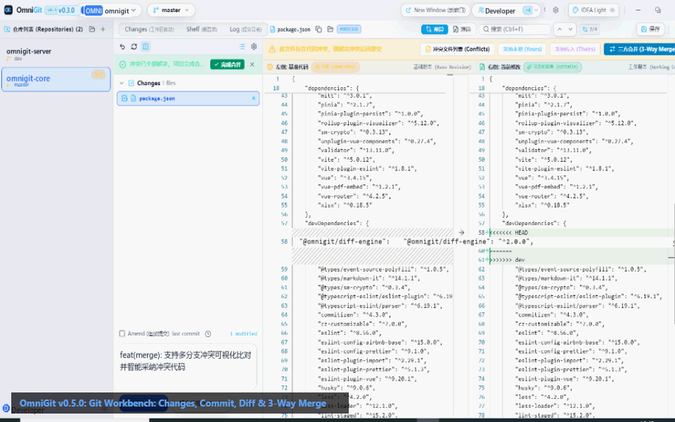
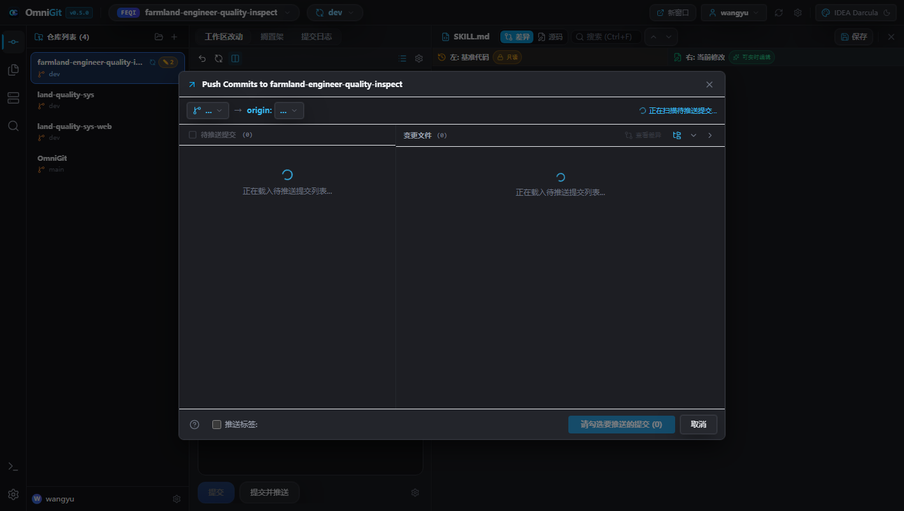
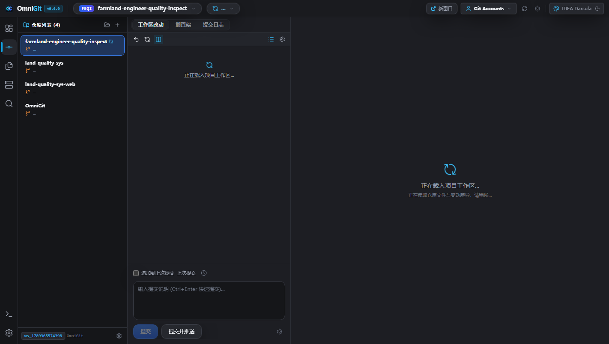
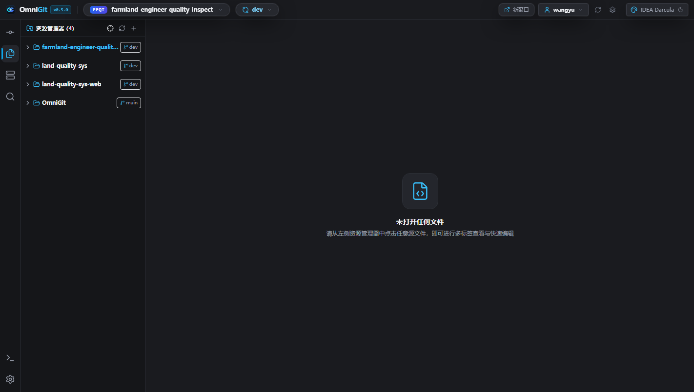
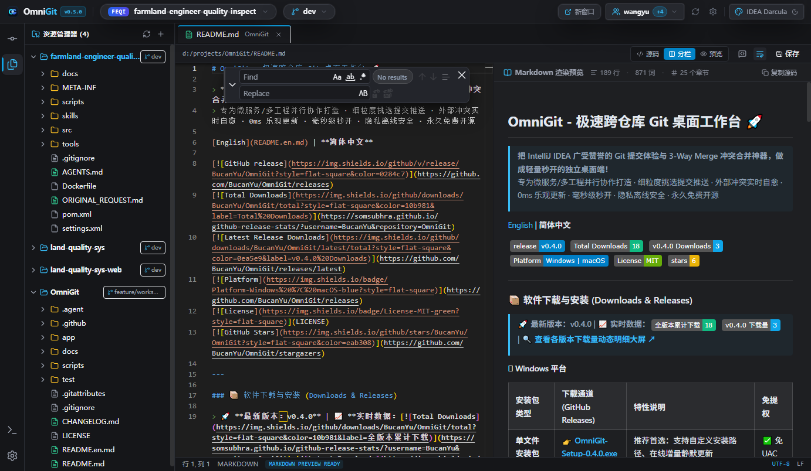
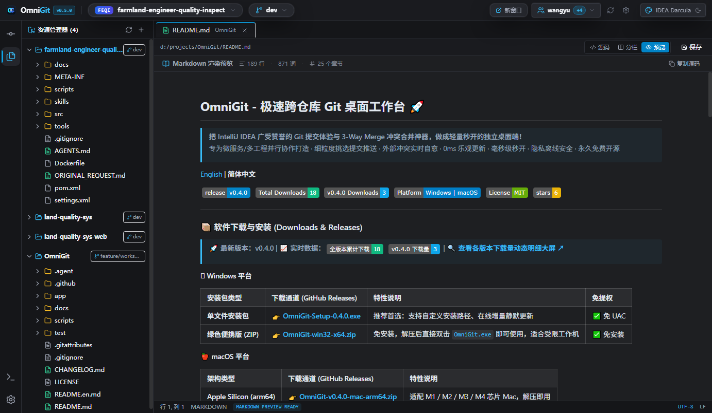
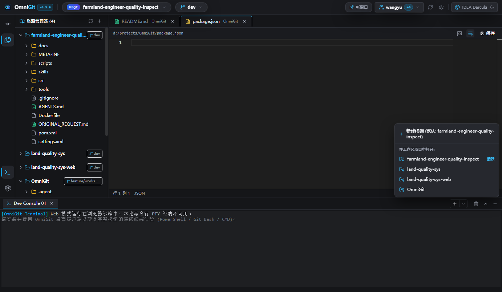
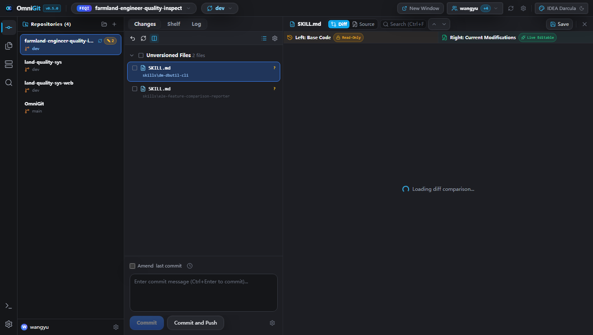
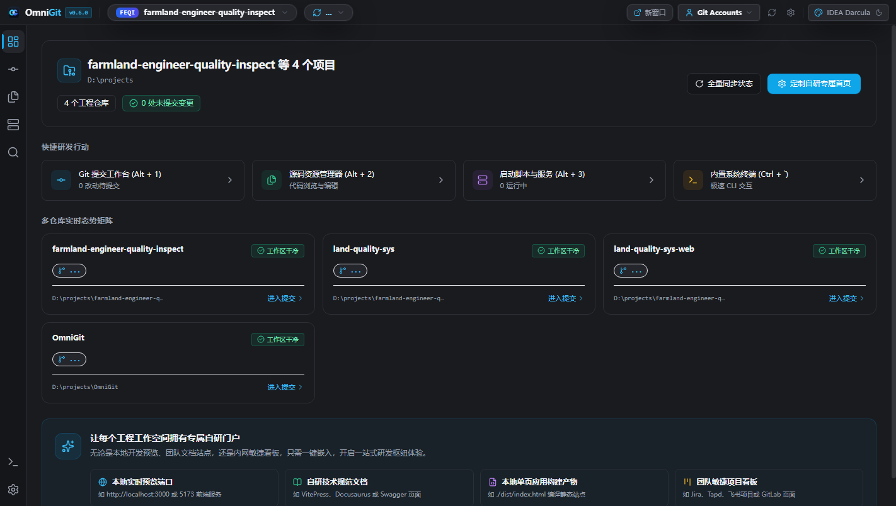

# OmniGit - 极速多工程 Git 协作与本地微服务开发工作台 🚀

> **以 IntelliJ IDEA 广受赞誉的 Git 提交体验与 3-Way Merge 冲突合并为核心，深度融合多工程源码资源管理、Monaco 代码编辑、Markdown 实时渲染、VS Code 级终端 Dock 与多微服务启动编排管理，专为现代开发者打造的超轻量秒开一体化工作台！**  
> 
> 专为微服务/多工程并行协作打造 · 细粒度挑选提交推送 · 外部冲突实时自愈 · 多微服务一键启停与 ANSI 实时日志 · 智能标签消歧 · 0ms 乐观水合 · 毫秒级秒开 · 隐私离线安全 · 永久免费开源

[English](README.en.md) | **简体中文**

[](https://github.com/BucanYu/OmniGit/releases)
[](https://somsubhra.github.io/github-release-stats/?username=BucanYu&repository=OmniGit)
[](https://github.com/BucanYu/OmniGit/releases/latest)
[](https://github.com/BucanYu/OmniGit/releases)
[](LICENSE)
[](https://github.com/BucanYu/OmniGit/stargazers)

---

### 📦 软件下载与安装 (Downloads & Releases)

> 🚀 **最新正式版：v0.5.0** | 📈 **实时数据：[](https://somsubhra.github.io/github-release-stats/?username=BucanYu&repository=OmniGit) [](https://github.com/BucanYu/OmniGit/releases/latest)** | 🔍 **[查看各版本下载量动态明细大屏 ↗](https://somsubhra.github.io/github-release-stats/?username=BucanYu&repository=OmniGit)**

#### 🪟 Windows 平台
| 安装包类型 | 下载通道 (GitHub Releases) | 特性说明 | 免提权 |
| :--- | :--- | :--- | :---: |
| **单文件安装包** | 👉 **[OmniGit-Setup-0.5.0.exe](https://github.com/BucanYu/OmniGit/releases/latest)** | 推荐首选：超高压缩比 (仅 76MB)，支持自定义路径与在线增量静默更新 | ✅ 免 UAC |
| **绿色便携版 (ZIP)** | 👉 **[OmniGit-win32-x64.zip](https://github.com/BucanYu/OmniGit/releases/latest)** | 免安装，解压后直接双击 `OmniGit.exe` 即可使用，适合受限工作机 | ✅ 免安装 |

#### 🍎 macOS 平台
| 架构类型 | 下载通道 (GitHub Releases) | 特性说明 |
| :--- | :--- | :--- |
| **Apple Silicon (arm64)** | 👉 **[OmniGit-v0.5.0-mac-arm64.zip](https://github.com/BucanYu/OmniGit/releases/latest)** | 原生适配 M1 / M2 / M3 / M4 芯片 Mac，解压即用 |
| **Intel (x64)** | 👉 **[OmniGit-v0.5.0-mac-x64.zip](https://github.com/BucanYu/OmniGit/releases/latest)** | 适配 Intel 架构 Mac，解压即用 |

> 💡 **版本与归档查询**：  
> - 想要查看更多历史版本（如 v0.4.0、v0.3.0）的安装包与更新记录？欢迎访问 👉 **[GitHub Releases 历史版本归档](https://github.com/BucanYu/OmniGit/releases)**  
> - 想要实时监控各文件的每日下载增长趋势与柱状图分析？欢迎访问 👉 **[GitHub Release Stats 数据看板](https://somsubhra.github.io/github-release-stats/?username=BucanYu&repository=OmniGit)**

---

## 🎬 核心功能全景动态演示 (Live Walkthrough)

> 以下动画展示了 OmniGit 最新版的核心全流程：从 **Git 核心工作台与 3-Way Merge 冲突合并**、**免检出精细化推送**，到**多工程资源树与 Monaco 代码编辑**、**Markdown 实时双栏拖拽渲染**、**VS Code 级终端 Dock**，再到**多微服务启动编排与实时彩色 ANSI 控制台日志**。



---

## 💡 为什么需要 OmniGit？

随着现代软件架构演进，开发者（尤其是使用 VS Code、Cursor、Sublime 或命令行终端的工程师）在微服务与多仓库协作中常常面临这些核心痛点：

1. **Git 分支合并冲突令人头疼**：普通编辑器里手动修改 `<<<<<<< HEAD` 提心吊胆，生怕手滑删错逻辑或遗漏冲突标记导致构建流水线挂掉；
2. **大型 IDE 太重太吃内存**：IntelliJ IDEA / WebStorm 的 Git 提交与三方合并体验确实是行业天花板，但动辄霸占 2~4GB 内存，冷启动漫长。只为了解决一个 Git 冲突或提交几个微服务就开庞大 IDE，电脑卡顿发烫；
3. **提交与推送控制不够灵活**：敏捷迭代中紧急 Bug 修复常与大需求代码混合在一起，普通客户端要么全部强推、要么必须切分支手动 Cherry-pick，操作繁琐且易改坏本地工作区；
4. **外部解决冲突工具不同步**：在习惯的外部编辑器改完冲突保存后，大部分 Git 客户端依然卡在冲突页面，还需手动输入 `git add` 确认；
5. **多微服务启动与日志管理极其繁琐**：Monorepo 或微服务架构需要同时拉起多个后端、前端与辅助服务，开发者桌面上堆满七八个黑框控制台（CMD/Bash），窗口来回切换令人烦躁，且极易产生残留的孤儿进程；
6. **上下文割裂与多窗口切换**：日常排查代码仅需查阅几个源文件、运行一条启动命令或临时敲两条 Git 命令，必须在臃肿的编辑器、多端命令行和 Git 工具之间开开合合；
7. **主流独立 Git 客户端缺陷明显**：
   - **SourceTree**：界面老旧臃肿，在 Windows 上频繁无响应假死，且强绑 Atlassian 账号；
   - **GitKraken**：商业化严重，私有仓库和三方合并冲突强制按月付费订阅；
   - **Fork**：商业收费软件（$49.99 且闭源）。

**OmniGit 为终结这些痛点而生**——它将 JetBrains 最受开发者推崇的 Git 协作哲学与 3-Way Merge 完整抽离，同时将**多工程工作区管理、Monaco 代码编辑、Markdown 实时双栏渲染、VS Code 风格终端 Dock 以及多微服务启动编排中心**深度融为一体，封装成一个**启动只需 1 秒、内存仅几十兆、双端无缝同构、完全免费开源**的现代化一体化开发工作台。

---

## ✨ 核心杀手锏特性

### 1. 🎯 专业级 3-Way Merge 可视化冲突解决神器 (Git 核心)


- **直观三栏比对**：左侧本地修改 (Yours) · 中间合并结果 (Result) · 右侧传入修改 (Theirs)；
- **双向箭头一键采纳**：点击双向箭头智能保留/丢弃代码，中间区域实时合成最终代码，彻底告别手工编辑冲突标记的恐惧；
- **防漏提语法安全拦截**：若工作区仍有包含 `<<<<<<<` 标记的冲突文件，系统坚决阻断提交并给出精准高亮指引，绝不让半成品代码流入远程主干；
- **外部冲突消除实时自愈**：当在 VS Code、Sublime 等外部编辑器消除冲突标记并保存时，后台自动探测并完成安全暂存（`git add`），冲突状态即刻自动解除；
- **中文路径全链路自愈**：底层全量注入 `-c core.quotepath=false` 并自带八进制反转义，杜绝中文字符乱码，无论路径多深均能精准定位。

---

### 2. 🚀 免检出精细化挑选提交推送 (Zero-Checkout Selective Push)


- **免检出切换分支推送 (Zero-Checkout Push)**：
  - 推送弹窗支持自由切换源分支与远端目标分支，无需在本地执行检出即可将指定分支推送到远程；
- **待推送提交多选与单提交独立推送**：
  - 待推送列表支持独立复选框（Checkbox），自由勾选一个或多个提交；
  - 支持将勾选的提交**直推远端分支**，或一键**新建补丁分支并推送**（如 `patch/fix-xxx`），便于发起 PR / Code Review，全程不污染本地当前开发分支；
- **截止到此提交推送 (Push Up To Here)**：
  - 右键任意历史提交卡片，支持仅推送截止到该节点的提交，敏捷隔离后续未测需求代码；
- **提交日志跨分支一键同步 (Cross-Branch Cherry-pick & Sync)**：
  - 在【提交日志】右键一键将已提交内容同步到 `test`、`uat` 等其他环境分支，并支持同步后自动推送到远程。

---

### 3. 🛠️ 多微服务启动与脚本统一编排中心 (Services & Launch Scripts Manager)


- **脚本驱动工作流 (Script-Centric Workflow)**：
  - 自动深度扫描工程内的启动脚本（`package.json` scripts、`.bat`、`.sh` 等）；
  - 支持快捷创建与编辑自定义启动脚本、停止脚本（Stop Script）及环境变量；
- **Monorepo 嵌套工程自适应**：
  - 智能感知多级嵌套工程目录，自动推导并绑定正确的执行工作目录 (Working Directory)；
- **拖拽排序与持久化 (Drag-to-Reorder)**：
  - 鼠标拖拽启动脚本卡片自由调整编排顺序，配置自动持久化跨会话记忆；
- **流式实时彩色 ANSI 日志控制台**：
  - 基于 SSE 协议的高性能实时控制台流，原生支持彩色 ANSI 渲染与 OSC 窗口标题过滤；
  - **智能自动滚动 (Auto-Scroll)**：默认保持贴底滚动，向上回滚排查时自动锁定视野，点击悬浮按钮一秒回到底部；
  - **字符流防乱序**：内置流式行缓冲分片合并，完美兼容 Windows GBK 与 Linux/macOS UTF-8 混合字符输出；
- **微服务一键启停与孤儿进程守护**：
  - 顶部一键启动/停止全部微服务，运行数量实时绿灯角标显示；
  - 采用非阻塞异步进程启停，彻底杜绝 UI 线程卡死；退出时自动清理子进程，严防孤儿进程残留占满端口。

---

### 4. 📂 多工程工作区资源管理器 (Multi-root Workspace Explorer)


- **跨仓库同屏聚合**：专为微服务、前后端分离与 Monorepo 打造，支持在一个窗口内并发展开多个工程目录树，快速收折与层级钻取；
- **智能文件类型识别**：基于扩展名与文件属性提供标准代码图标，开发上下文一目了然；
- **严苛去重与并发打开锁**：内置单飞保护锁机制，彻底避免同一文件被重复开启多个标签页的 Bug；再次点击已开文件时自动平滑聚焦至已有标签；
- **一键唤起系统资源管理器**：鼠标悬停工程卡片即可一键打开系统原生文件夹，告别层层寻路。

---

### 5. 💻 Monaco 轻量源码编辑器 & 智能标签栏 (Monaco Code Editor & Smart Tabs)


- **毫秒级离线渲染**：集成与 VS Code 同源的 Monaco Editor，全本地资源秒开（< 50ms），支持主流编程语言语法高亮与行号定位；
- **智能同名标签消歧 (Smart Disambiguation)**：当不同工程中打开同名文件（如多个 `package.json` 或 `index.ts`）时，标签栏自动提取上级目录名称消歧标识，彻底杜绝混淆；
- **横向滚轮滚动与标签溢出抽屉 (Overflow Drawer Menu)**：标签过多时支持鼠标滚轮平滑横向滑动，右侧提供下拉溢出菜单快速跳转；
- **智能快捷注释 (<kbd>Ctrl + /</kbd>)**：一键切换单行/多行注释与反注释，原生支持通用源码、HTML 及 Markdown 块注释；
- **极客悬浮查找替换 (<kbd>Ctrl + F</kbd>)**：
  - 经典 Darcula / VS Code 风格悬浮卡片；
  - 完整支持大小写敏感 (`Aa`)、全词匹配 (`Ab`)、正则表达式 (`.*`)；
  - 实时命中计数统计（`1/N`）与上下匹配项平滑导航。

---

### 6. 📝 Markdown 双栏实时渲染与自由中缝拖拽 (Markdown Live Preview)


- **GitHub 原生排版保真渲染**：完美支持 Markdown 标题、表格、代码高亮、Checklist 及 GitHub 状态徽章；
- **本地相对图片离线渲染**：内置 `/api/fs/raw` 资源管道，文档中引用的本地相对路径图片（如 `./docs/images/xxx.png`）全保真即时加载；
- **自由按住中缝鼠标拖拽**：支持平滑左右拖动分隔线调整编辑器与预览区宽度分配，断电跨会话记忆比例；
- **双击中缝瞬间居中**：无论拖动到何种比例，只需双击中缝分割线，立即精准重置为标准的 50:50 黄金比例；
- **一键全屏沉浸纯阅读**：工具栏提供「源码 / 分栏 / 全屏纯阅读」三模快速切换，兼顾编写与阅读体验。

---

### 7. 🖥️ 深度对齐 VS Code 交互的集成终端 Dock (Integrated Terminal)


- **底部多标签 PTY 命令行**：支持 PowerShell、Git Bash、CMD 独立多会话并发运行；
- **双击自定义重命名标签**：随心为终端命名（如 `Backend Dev`、`Vite Watcher`），多任务管理井井有条；
- **严格对齐 VS Code 图标语言与操作直觉**：
  - <kbd>—</kbd>（减号）：快速收起/折叠终端抽屉；
  - <kbd>🗑️</kbd>（垃圾桶）：一键杀掉当前终端进程并关闭标签；
  - <kbd>^</kbd> / <kbd>v</kbd>：终端面板最大化与高度还原切换；
- **向上弹出的安全切换菜单**：新建终端下拉列表采用自适应向上弹出设计，彻底根除被窗口底部任务栏截断的体验硬伤。

---

### 8. ⚡ 独创“撤销合并 (Undo Merge)”安全回退机制
- 分支合并（如 `git merge dev`）后发现改动过多想反悔？
- 顶部专属提供 **1-Click 撤销合并**，即使中途客户端重启或清理缓存，依然能从 Git 历史树中智能锚定合并前状态，附带高风险操作二次确认，一秒无损复原工作区。

---

### 9. 🌐 桌面与 Web 双端无缝同构、纯正双语体系与离线安全


- **桌面 + Web 双端体验无缝对齐**：既可作为高性能 Electron 桌面独立客户端运行，亦可通过浏览器直接访问局域网/开发机，全套功能与 SSE 流日志完全等价；
- **纯正双语体系**：中文模式彻底消除中英杂糅，呈现纯正自然表达；鼠标悬停气泡提示专业英文对照与 IDEA 快捷键（`Ctrl+K` 调出提交、`Ctrl+Shift+K` 一键推送）；
- **经典主题预设**：内置 Darcula、IDEA Light、Nord Frost 等经典配色，暗黑与明亮模式随心切换；
- **0ms 瞬时水合秒开**：结合 L1 内存 / L2 本地存储 / L3 磁盘快照，打开工作空间首屏 0 延迟秒开，无白屏、无闪烁；
- **全内置物理隔离**：**绝不上传任何用户代码与账户凭证**，100% 离线数据安全。

---

### 10. 🌐 工作空间自研研发门户与微前端大盘 (Workspace Custom Dashboard)


- **快捷键 <kbd>Alt + 0</kbd> 一键直达**：
  - 默认全景态势大盘：聚合多仓库分支胶囊、未提交改动数、未拉/未推指示器、微服务状态与自研门户模版向导；
  - 视图 Keep-Alive 保活机制：在 Git 工作台、源码编辑器与自研首页之间无缝切换，子应用页面状态不丢失、不重载；
- **四大典型应用场景开箱即用**：
  - **本地实时预览端口**：嵌入运行中的 Next.js / Vite / Vue CLI 前端服务（如 `http://localhost:3000` 或 `5173`），沉浸式预览热更新；
  - **自研技术规范与 API 文档站点**：集成 VitePress、Docusaurus、Swagger UI 或 Storybook，边查接口规范边开发；
  - **本地单页构建产物挂载**：直接挂载 `./dist/index.html` 编译产物，内置静态托管服务并智能动态注入 `<base>` 标签，彻底避免 SPA 相对路径 404 白屏；
  - **团队敏捷项目看板**：无缝嵌入 Jira、TAPD、飞书项目、GitLab Issues 等团队看板；
- **零信任受控双向交互桥接 (`OmniGitBridge`)**：
  - 基于 `postMessage` 与单次会话随机 Token 强验真握手，杜绝任何命令注入与系统级提权风险；
  - 支持从自研页面直接跳转至 OmniGit 核心面板（`git`、`explorer`、`services`），支持传参直接激活指定仓库；
  - 支持在内置 Monaco 编辑器中定位打开相对路径代码文件；
  - 支持监听宿主明暗主题实时切换自适应；
- **团队协同配置共享 (`.omnigit/dashboard.json`)**：
  - 在工作空间根目录生成团队级配置并提交至 Git，全员拉取代码后自动统一研发首页；
- **详细接入开发指南与 AI 提示词**：
  - 完整协议规范、极简客户端 SDK 与 AI 提示词模板请参阅 👉 **[工作空间自研研发门户与系统联动交互完整开发指南](docs/CUSTOM_DASHBOARD_GUIDE.md)**。

---

## 📊 主流开发与 Git 客户端全方位横向对比

| 核心维度 | **OmniGit** | SourceTree | GitKraken | Fork | VS Code 原生 |
| :--- | :---: | :---: | :---: | :---: | :---: |
| **定位范畴** | **Git 核心 + 多工程微服务工作台** | 传统 Git 客户端 | 传统 Git 客户端 | 传统 Git 客户端 | 通用文本编辑器 |
| **开源与授权** | **100% 免费开源 (MIT)** | 免费闭源 | 免费版阉割 / 付费订阅 | $49.99 商业收费 | 免费开源 |
| **三方冲突解决 (3-Way Merge)** | **原生三栏可视化比对** | 需配置外部工具 | 核心功能强制收费 | 原生支持 | 需安装复杂插件 |
| **外部冲突解决自愈** | **原生实时探测自动暂存** | 无，需手动暂存 | 需手动刷新暂存 | 需手动暂存 | 需手动暂存 |
| **多微服务启动编排 & ANSI 日志** | **原生内置 (支持脚本发现/启停/排序)** | 无 | 无 | 无 | 需插件或脚本 |
| **免检出精细化推送 / 补丁分支** | **原生支持 (多选提交/补丁分支)** | 仅支持整分支推送 | 较复杂 | 基础操作 | 仅支持整分支推送 |
| **多工程资源树 & Monaco 编辑器** | **原生内置 (智能消歧/中缝拖拽)** | 无 | 无 | 无 | 原生具备 |
| **集成终端 Dock** | **原生内置 (VS Code 规范)** | 无，仅外置终端 | 内置终端 | 仅外置终端 | 原生具备 |
| **一键撤销合并 (Undo Merge)** | **原生支持 (带历史自愈)** | 需敲复杂命令行 | 需复杂历史树回退 | 需手动回滚 | 无 |
| **跨分支同步提交** | **日志右键一键 Cherry-pick 同步** | 需手动检出分支 | 步骤繁琐 | 支持 | 需手动执行命令 |
| **启动速度与安装包体积** | **秒开 / 76MB 极致优化** | 较重、易无响应 | 较重 (> 200MB) | 原生轻量 | 随完整编辑器启动 |
| **第三方账号绑定** | **零绑定 (下载即用)** | 强制登录 Atlassian | 强制注册账号 | 免绑定 | 免绑定 |

---

## ⌨️ 常用高效快捷键指引 (Shortcuts)

| 快捷键 | 作用范围 | 功能说明 |
| :--- | :--- | :--- |
| <kbd>Alt + 0</kbd> | 全局 | 快速切换至 **工作空间研发首页 / 全景大盘** 视图 |
| <kbd>Alt + 1</kbd> | 全局 | 快速切换至 **Git 核心工作台** 视图 |
| <kbd>Alt + 2</kbd> | 全局 | 快速切换至 **工作区源码资源管理器** 视图 |
| <kbd>Alt + 3</kbd> | 全局 | 快速切换至 **微服务启动编排面板** 视图 |
| <kbd>Ctrl + K</kbd> | Git 视图 | 快速聚焦提交说明输入框，准备提交改动 |
| <kbd>Ctrl + Shift + K</kbd> | Git 视图 | 唤起精细化挑选推送弹窗 (Selective Push) |
| <kbd>Ctrl + Enter</kbd> | 提交面板 | 快速执行提交当前选中的文件 |
| <kbd>Ctrl + F</kbd> | Monaco 编辑器 | 唤起现代悬浮查找与替换小部件 |
| <kbd>Ctrl + /</kbd> | Monaco 编辑器 | 智能添加 / 移除当前行或选中块的代码注释 |
| <kbd>Ctrl + Shift + F</kbd> | 全局 | 唤起工作区跨文件全局搜索弹窗 |
| <kbd>Ctrl + `</kbd> | 全局 | 快速唤起或隐藏底部集成终端 Dock |

---

## 🛠️ 开发者指南 (Local Development)

所有便捷控制脚本均统一存放在 [`scripts/`](scripts/) 目录下（详见 [`scripts/README.md`](scripts/README.md)）：

### 1. 启动桌面端预览
```bash
# 方式一：双击运行 scripts/start_desktop.bat
# 方式二：命令行启动
cd app
npm run electron:preview
```

### 2. 启动 Web 调试端 (HMR 热重载)
```bash
# 方式一：双击运行 scripts/start_dev.bat (自动打开 http://localhost:5345)
# 方式二：命令行启动
cd app
npm run dev
```

### 3. 一键编译打包 Windows 安装程序
直接双击运行根目录脚本：👉 **[`scripts/build_desktop.bat`](scripts/build_desktop.bat)**。  
脚本会自动执行 TypeScript 类型校验、前端资源打包、图标注入与高压缩比 NSIS 压制，在 `app/release/` 输出单文件商业级安装包（体积约 76MB）。

### 4. 自动化回归测试流水线
```bash
# 运行后端 API 与端到端回归测试
npm run test:e2e
# 运行多微服务生命周期端到端测试
node app/scripts/test-e2e-services.cjs
```

---

## 📂 项目结构概览

```text
OmniGit/
├── app/                              # 应用核心工程
│   ├── electron/                     # Electron 桌面端主进程与自动更新
│   │   ├── main.ts                   # 窗口生命周期、本地私有调度服务与环境探测
│   │   ├── preload.ts                # 安全预加载脚本
│   │   └── updater.ts                # 基于 GitHub Releases 的静默检查与更新
│   ├── src/                          # 前端源码 (React 18 + Zustand + Tailwind)
│   │   ├── components/               # 通用基础组件 (Modal, Button, Input, Dropdown)
│   │   ├── features/                 # 核心业务模块
│   │   │   ├── activity-bar/         # 左侧核心活动栏 (Git工作台 / 资源管理 / 微服务编排)
│   │   │   ├── conflict-3way/        # 3-Way Merge 可视化三方冲突合并器
│   │   │   ├── diff-editor/          # Monaco 双栏/单栏差异比对面板
│   │   │   ├── editor/               # Monaco 源码编辑器、查找替换与 Markdown 渲染
│   │   │   ├── git-log/              # 提交日志、分支历史树与跨分支同步弹窗
│   │   │   ├── git-push/             # 分支选择、提交多选与精细化推送弹窗
│   │   │   ├── git-status/           # 工作区改动 (Changes)、搁置架 (Shelf)、提交面板
│   │   │   ├── services/             # 多微服务启动与脚本统一编排中心 (实时ANSI日志流)
│   │   │   ├── terminal/             # VS Code 风格集成终端 Dock (PTY 多会话管理)
│   │   │   ├── topbar/               # 顶栏分支菜单、撤销合并、身份切换与全局操作
│   │   │   └── workspace/            # 多工程文件资源树与工作区管理
│   │   ├── locales/                  # 纯正双语国际化字典与类型化解析 (zh-CN / en-US)
│   │   ├── server/                   # 本地调度引擎与 API 服务 (Git/文件系统/服务进程)
│   │   └── store/                    # 全局状态管理 (useAppStore, 0ms 乐观更新机制)
│   ├── electron-builder.yml          # NSIS 单文件打包配置
│   └── package.json                  # 依赖与脚本
├── docs/                             # 架构设计、PRD、图文教程与高清素材
│   ├── images/                       # 核心界面高清预览图与演示动图
│   │   ├── omnigit_demo.gif          # 全景动态演示动图
│   │   ├── omnigit_demo.webm         # 全景动态演示视频
│   │   ├── 01_omnigit_workbench.png  # 3-Way Merge 冲突解决与 Git 核心工作台
│   │   ├── 02_workspace_explorer_editor.png # 资源管理器与代码编辑器
│   │   ├── 03_markdown_split_preview.png    # Markdown 双栏渲染与全屏预览
│   │   ├── 04_terminal_dock.png      # 集成终端 Dock 与新建菜单
│   │   ├── 05_find_replace_monaco.png# Monaco 悬浮查找替换小部件
│   │   ├── 06_english_mode_ui.png    # 纯正英文模式 UI
│   │   ├── 07_services_orchestrator.png     # 多微服务启动编排与实时日志
│   │   └── 08_selective_push_modal.png      # 分支免检出切换与精细化推送
│   └── OmniGit_PRD.md                # 架构设计与产品规格说明书
├── scripts/                          # 开发者运维工具箱与便携版 NSIS
├── test/                             # 自动化 E2E 与基准测试工程
└── README.md                         # 项目总说明文档 (简体中文)
```

---

## 🤝 参与贡献与问题反馈

欢迎每一位热爱效率的开发者参与共建！
- 遇到 Bug 或有新功能想法？欢迎提交 [Issues](https://github.com/BucanYu/OmniGit/issues)
- 觉得好用？请给本项目点个 ⭐️ **Star** 鼓励一下作者，让更多开发者发现这款工具！

---

## 📄 开源许可证

本项目基于 [MIT License](LICENSE) 许可证开源，您可以自由商用、修改与分发。
