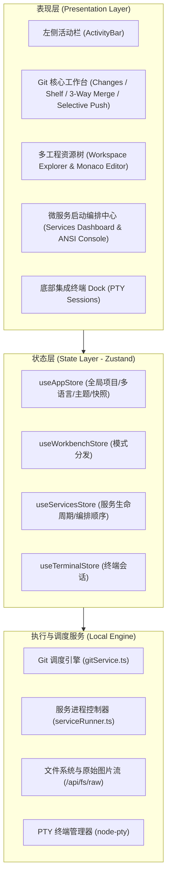

# OmniGit - 产品需求与系统架构规格说明书 (PRD & Architecture)

## 1. 产品定位与演进 (Product Positioning & Vision)

> **定位升级**：OmniGit 从最初的独立 Git 客户端，全面升级为**以 Git 协作与 3-Way Merge 冲突解决为核心、深度融合多工程工作区源码管理、Monaco 代码编辑与 Markdown 实时渲染、VS Code 级终端 Dock 以及多微服务启动编排管理的轻量级现代化开发工作台 (Modern Multi-Repo Development Workbench & Git Center)**。

- **核心价值主张**：
  1. **Git 依然是系统功能的绝对核心**：无缝还原 IntelliJ IDEA 广受推崇的 Git 提交哲学、分支同步指示器与专业 3-Way Merge 三方冲突合并器；
  2. **终结本地微服务与多仓库割裂**：解决现代微服务、Monorepo 及前后端并行开发中，需要打开臃肿 IDE、手动在黑框中敲脚本启动 5~8 个服务、以及在多个窗口之间反复切换的巨大心智负担；
  3. **极致性能与轻量**：启动时间 < 1s，内存消耗仅约 60MB，安装包 76MB，桌面与 Web 浏览器双端无缝同构，100% 离线数据隐私安全。

---

## 2. 系统核心功能中枢 (Core Functional Hubs)

### 2.1 Git 核心中枢 (Core Git Engine & Workbench) - 系统的核心基石
- **3-Way Merge 可视化三方冲突合并器**：
  - 左侧本地改动 (Yours) · 中间合并产物 (Result) · 右侧传入改动 (Theirs)；
  - 智能双向箭头一键采纳/丢弃；
  - 严格防漏提校验：若工作区仍有包含 `<<<<<<<` 标记的文件，强行阻断提交；
  - 外部冲突实时自愈：外部编辑器保存后，自动触发安全暂存并解除冲突状态；
  - 全链路中文与 Unicode 路径自愈（`-c core.quotepath=false` + `decodeGitPath`）。
- **免检出精细化挑选推送 (Zero-Checkout Selective Push)**：
  - 推送弹窗内直接自由选择源分支与远程目标分支，免去物理切分支切换成本；
  - 待推送提交多选 Checkbox，支持单提交或多选提交直推远程分支，或一键抽取为独立补丁分支（Patch Branch）并发起 PR；
  - “截止到此提交推送 (Push Up To Here)”：一键推送截止到特定节点的提交，隔离未测代码；
  - 提交日志跨分支一键同步（Cherry-pick & Push 到其他分支）。
- **撤销合并 (Undo Merge)**：
  - 顶栏常驻撤销合并安全回退机制，从 Git 历史树中智能锚定合并前状态并带二次确认。

### 2.2 多微服务启动与脚本统一编排中心 (Services & Launch Scripts Manager) - 重磅全新模块
- **脚本驱动工作流 (Script-Centric Workflow)**：
  - 自动扫描工作区所有工程的 `package.json` scripts、`.bat`、`.sh`；
  - 支持手动创建与编辑独立服务卡片、自定义启动参数、停止脚本与环境变量；
- **Monorepo 嵌套目录自适应推导**：
  - 递归解析子工程实际物理路径，自动将进程执行的 `cwd` 绑定到对应子目录；
- **卡片自由拖拽排序与跨会话持久化**：
  - 允许开发者根据依赖顺序自由拖拽服务卡片，启动顺序自动保存；
- **流式实时彩色 ANSI 控制台日志流**：
  - 基于 SSE 协议的高性能日志通道，原生解析 ANSI 颜色代码；
  - 过滤和清洗控制台 OSC 窗口标题污染序列；
  - **智能自动滚动 (Auto-Scroll)**：默认保持贴底最新日志输出；向上查阅时自动锁定视野，悬浮按钮一键回滚；
  - **分片行缓冲合并**：兼容 Windows GBK 与 Linux/macOS UTF-8，彻底解决多字节字符跨分片乱码；
- **一键编排启停与孤儿进程守护**：
  - 顶部一键启动/停止全部微服务，运行服务数量实时绿灯角标；
  - 非阻塞异步启停防止 UI 卡死，退出时级联终止进程树，杜绝孤儿进程残留占满端口。

### 2.3 多工程工作区资源管理器 (Multi-root Workspace Explorer)
- **跨仓库同屏聚合**：一个窗口内并发展开多个工程目录树，快速收折与层级钻取；
- **单飞防重锁**：杜绝同一文件重复开启多个标签页，已开文件平滑聚焦；
- **文件定位**：一键在操作系统资源管理器中定位/展开。

### 2.4 Monaco 源码编辑器 & Markdown 实时渲染 (Editor & Live Preview)
- **VS Code 同源 Monaco Editor**：全本地离线资源秒开（< 50ms），语法高亮与行号定位；
- **智能同名标签消歧 (Smart Tab Disambiguation)**：同名文件标签自动以次级文本呈现差异化父目录名（如 `core:index.ts` vs `ui:index.ts`）；
- **横向滚轮与标签溢出抽屉 (Overflow Drawer Menu)**：标签过多时平滑滚动，并支持抽屉菜单快速模糊检索；
- **智能快捷注释 (<kbd>Ctrl + /</kbd>) 与悬浮查找替换 (<kbd>Ctrl + F</kbd>)**；
- **Markdown 左右分栏实时渲染**：
  - 支持本地相对路径图片离线渲染（`/api/fs/raw` 管道）；
  - 中缝自由鼠标拖拽调节比例，双击居中 50:50，三模切换（源码/分栏/全屏）。

### 2.5 集成终端 Dock (Integrated Terminal Dock)
- **多会话并发**：支持 PowerShell、Git Bash、CMD 独立多会话；
- **对齐 VS Code 交互语言**：`-` 减号收起、`🗑️` 销毁会话、`^`/`v` 展开与折叠；
- **双击标签重命名**；
- **向上自适应弹出新建下拉菜单**。

---

## 3. 技术架构与核心原则 (Technical Architecture)

- **底层执行原则**：绝不魔改底层 Git 数据结构，通过极速执行和解析原生 Git CLI 命令实现；
- **服务隔离与同构**：同时支持 Electron 原生桌面端与轻量 Web 浏览器端，所有核心 API 与 SSE 日志流在两端 100% 同构；
- **大文件模块化协议**：单个文件行数控制在 400 行以内，超过 800 行强制触发模块化子组件拆分，并通过 Facade 模式对外重导出保持 100% 向后兼容。

---

## 4. 交互与设计规范 (UX & Standards)

1. **纯正多语言隔离规范**：
   - 中文环境（`zh-CN`）彻底净化中英文夹杂，呈现纯正自然表达；
   - 英文模式（`en-US`）保持专业严谨；
   - 术语对照与快捷键收敛于悬停气泡（Hover Tooltip）。
2. **0ms 瞬时水合与乐观响应**：
   - 利用 L1 内存 / L2 LocalStorage / L3 磁盘快照实现毫秒级打开工作区；
   - 所有服务状态变更（启动中、停止中、已解决）优先触发乐观状态更新，杜绝操作假死。
3. **高风险操作二次确认**：
   - 撤销合并（Undo Merge）、丢弃改动（Rollback）、删除分支等操作必须经过独立弹窗二次确认。
