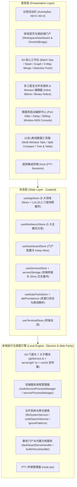

# OmniGit - 产品需求与系统架构规格说明书 (PRD & Architecture)

## 1. 产品定位与演进 (Product Positioning & Vision)

> **定位升级 (v0.6.0+)**：OmniGit 从最初的独立 Git 客户端，全面升级为**以 Git 协作与 3-Way Merge 冲突解决为核心、深度融合工作空间自定义研发门户 (`Alt+0`)、多工程源码资源管理 (`Alt+2`)、Monaco 代码编辑与 Markdown 实时渲染、多微服务启动编排管理 (`Alt+3`)、全离线多格式数据格式化工具箱 (`Alt+4`) 以及 VS Code 级终端 Dock 的轻量级现代化一站式开发工作台 (Modern Multi-Repo Development Workbench & Portal)**。

- **核心价值主张**：
  1. **Git 依然是系统功能的绝对核心**：无缝还原 IntelliJ IDEA 广受推崇的 Git 提交哲学、分支同步指示器、多仓库批量协同、Stash 暂存架、分支拓扑图、行级 Blame 溯源与专业 3-Way Merge 三方冲突合并器；
  2. **终结本地微服务、多仓库与常用工具割裂**：解决现代微服务、Monorepo 及前后端并行开发中，需要打开臃肿 IDE、手动在黑框中敲脚本启动 5~8 个服务、以及为了格式化 JSON/JWT/时间戳在浏览器第三方网站间反复切换的巨大心智负担与隐私隐患；
  3. **极致性能、防卡死基线与超轻量**：启动时间 < 1s，日常驻留内存仅约 60MB，安装包约 76MB，桌面与 Web 浏览器双端无缝同构，100% 离线数据隐私安全。

---

## 2. 系统核心功能中枢 (Core Functional Hubs)

### 2.1 Git 核心中枢 (Core Git Engine & Workbench - `Alt + 1`) - 系统的核心基石
- **3-Way Merge 可视化三方冲突合并器**：
  - 左侧本地改动 (Yours) · 中间合并产物 (Result) · 右侧传入改动 (Theirs)；
  - 智能双向箭头一键采纳/丢弃；
  - 严格防漏提校验：若工作区仍有包含 `<<<<<<<` 标记的文件，强行阻断提交；
  - 外部冲突实时自愈：外部编辑器保存后，自动触发安全暂存并解除冲突状态；
  - 全链路中文与 Unicode 路径自愈（`-c core.quotepath=false` + `decodeGitPath`）。
- **免检出精细化挑选推送 (Zero-Checkout Selective Push)**：
  - 推送弹窗内直接自由选择源分支与远程目标分支，免去物理切分支切换成本；
  - 待推送提交多选 Checkbox，支持单提交或多选提交直推远程分支，或一键抽取为独立补丁分支（Patch Branch）并发起 PR；
  - “截止到此提交推送 (Push Up To Here)”：一键推送截止到特定节点的提交，隔离未测代码；
  - 提交日志跨分支一键同步（Cherry-pick & Push 到其他分支）。
- **多仓库批量协同操作 (Multi-Repo Batch Operations)**：
  - 左侧仓库列表顶栏支持对工作空间内所有仓库一键并发执行 **批量拉取 (Batch Pull)**、**批量抓取 (Batch Fetch)** 与 **批量切换同名分支 (Batch Checkout)**，实时汇总各仓库执行状态明细。
- **Git Stash 暂存架管理 (`StatusStashDrawer`)**：
  - 提交面板集成 Stash 暂存抽屉，支持一键暂存当前工作区修改（可选包含 Untracked 文件与自定义备注）、查看 Stash 列表、应用（Apply）、弹出（Pop）与删除（Drop）。
- **提交历史彩色分支拓扑图 (`CommitGraphLane`)**：
  - 基于 `%P` 多父节点拓扑关系，在提交历史中实时渲染彩色 SVG 分支演进、分叉与合并轨道图。
- **撤销合并 (Undo Merge)**：
  - 顶栏常驻撤销合并安全回退机制，从 Git 历史树中智能锚定合并前状态并带二次确认。

### 2.2 多微服务启动与脚本统一编排中心 (Services & Launch Scripts Manager - `Alt + 3`)
- **脚本驱动工作流与模块内项目快切 (Script-Centric Workflow & Project Switcher)**：
  - 自动扫描工作区所有工程的 `package.json` scripts、`.bat`、`.sh`；
  - 支持手动创建与编辑独立服务卡片、自定义启动参数、停止脚本与环境变量；
  - 面板左上角内置**模块内项目快速切换器**，直接切换工程并联动同步顶栏活跃 Git 仓库状态；
- **端口冲突实时嗅探与一键释放重启 (Port Conflict Detection & 1-Click Release)**：
  - 支持配置监听端口并自动嗅探实时日志中的 `EADDRINUSE` 端口占用错误；
  - 检测到端口被占用时高亮告警并提供**「一键释放端口并重启」**，异步查杀占用该端口的进程树并重新启动服务；
- **卡片拖拽排序、顺序启动延时 (`startDelayMs`) 与跨会话持久化**：
  - 允许开发者根据依赖顺序自由拖拽服务卡片，并配置启动前置延时（`startDelayMs`），在“一键全部启动”时按梯度依次拉起；
- **流式实时彩色 ANSI 控制台日志流与实时过滤**：
  - 基于 SSE 协议与 `StreamLogBuffer`（`32ms` 节流合并）的高性能日志通道，默认采用最新 350 行滑动窗口渲染，大幅降低 DOM 压力；
  - 原生解析 ANSI 颜色代码、清洗 OSC 窗口标题污染序列，并提供顶部实时关键字过滤搜索；
  - **手动滚动优先锁 (Scroll Priority Lock)**：默认保持贴底最新日志输出；当用户向上滚轮查阅时立即锁定视口，彻底阻断高频日志流强制跳底，悬浮按钮支持一键回到底部；
- **一次性任务脚本完成识别与孤儿进程守护**：
  - 自动绕过 Windows `.bat` 脚本中的阻塞式 `pause`，区分常驻微服务与一次性构建/工具脚本，退出码为 `0` 时自动标记为绿标 `已完成 (Completed)`；
  - 非阻塞异步启停防止 UI 卡死，退出时级联终止进程树，杜绝孤儿进程残留占满端口。

### 2.3 多工程工作区资源管理器 (Multi-root Workspace Explorer - `Alt + 2`)
- **跨仓库同屏聚合**：一个窗口内并发展开多个工程目录树，支持单子目录自动链式展开、快速收折与「一键折叠全部文件夹」；
- **解绑 Git 硬过滤，全量展示工作区文件**：
  - 移除对 `dist`、`build`、`target`、`.env*`、`node_modules` 的硬编码屏蔽（仅排除 `.git` / `.svn` / `.hg` 版本控制内部目录），确保开发者可随时查阅构建产物、环境配置与依赖源码；
  - 将 `.gitignore` 规则重构为非破坏性的 `isIgnored: boolean` 属性，对被忽略文件呈现半透明弱化样式，并在顶栏提供**「显示全部文件 / 隐藏 Git 忽略文件」**一键切换开关；
- **二进制与超大文件安全预览卡片 (`BinaryOrLargeFileNotice`)**：
  - 点击图片、压缩包、可执行程序或超过 2MB 的超大文件时，友好展示文件类型、体积、路径元数据卡片，并提供一键「使用系统默认应用打开」与「在系统资源管理器中定位」操作；
- **单飞防重锁**：杜绝同一文件重复开启多个标签页，已开文件平滑聚焦。

### 2.4 Monaco 源码编辑器 & Markdown 实时渲染 (Editor & Live Preview)
- **VS Code 同源 Monaco Editor**：全本地离线资源秒开（< 50ms），语法高亮与行号定位；
- **行级代码溯源 (`Inline Git Blame`)**：编辑器顶栏支持一键开启 `Git Blame`，展示每一行代码的提交 Hash、作者、相对时间与提交说明；
- **智能同名标签消歧 (Smart Tab Disambiguation)**：同名文件标签自动以次级文本呈现差异化父目录名；
- **横向滚轮与标签溢出抽屉 (Overflow Drawer Menu)**：标签过多时平滑滚动，并支持抽屉菜单快速模糊检索；
- **智能快捷注释 (<kbd>Ctrl + /</kbd>) 与悬浮查找替换 (<kbd>Ctrl + F</kbd>)**；
- **Markdown 左右分栏实时渲染與内置文档阅读**：
  - 支持本地相对路径图片离线渲染（`/api/fs/raw` 管道）与内置开发指南一键打开（`builtinDocsHandler`）；
  - 中缝自由鼠标拖拽调节比例，双击居中 50:50，三模切换（源码/分栏/全屏）。

### 2.5 集成终端 Dock (Integrated Terminal Dock - `` Ctrl + ` ``)
- **多会话并发**：支持 PowerShell、Git Bash、CMD 独立多会话；
- **对齐 VS Code 交互语言**：`-` 减号收起、`🗑️` 销毁会话、`^`/`v` 展开与折叠；
- **双击标签重命名**与向上自适应弹出新建下拉菜单。

### 2.6 工作空间自研研发门户与微前端大盘 (Workspace Custom Dashboard - `Alt + 0`)
- **默认全景工程态势大盘 (`DefaultDashboardView`)**：
  - 聚合多仓库分支胶囊、未提交改动数、待拉取/待推送计数 `↙ ↗` 与微服务运行状态，支持关键字过滤与一键跳转提交工作台；
- **微前端沙箱容器与 Keep-Alive 保活 (`EmbeddedFrameView`)**：
  - 支持嵌入本地实时开发端口、文档站点、本地静态 SPA 构建产物（`/api/workspace/dashboard-serve/:workspaceId/*` 自动注入 `<base>` 标签）及团队看板；
  - 采用 CSS `Keep-Alive` 保活，跨工作台切换不丢失子页面状态；
- **零信任双向通信桥接 (`OmniGitBridge`) 与团队共享配置 (`.omnigit/dashboard.json`)**：
  - 基于单次会话 Token 强校验，支持 `omnigit:navigate`、`omnigit:open-file`、`omnigit:sync-all`、`omnigit:get-workspace-info` 与明暗主题广播。

### 2.7 全离线多格式数据格式化与开发工具箱 (Data Tools Workbench - `Alt + 4`)
- **10 大高频数据格式与离线开发工具**：
  - **JSON / JSON5**（美化、压缩、Smart Fix 智能纠错、Key 递归排序、TypeScript `interface` 生成）、**YAML**、**XML / HTML**、**SQL**、**JWT Token**（离线解码与过期校验）、**URL Query**、**Base64**（UTF-8 无损编解码与只读预览）、**Timestamp 时间戳转换**、**UUID / Hash 生成器**（UUID v4 与 MD5/SHA1/SHA256/SHA512）、**Regex 正则测试器**（实时高亮与捕获组提取）；
- **IDE 级多窗口标签栏 (`DataToolsTabBar`) 与双栏分屏对比 (Side-by-Side Split Compare)**：
  - 支持点击 `+ 新增窗口` 下拉菜单选择任意格式开启多个独立窗口，跨会话持久化保存，并支持开启双窗口左右并排对比模式；
- **四维联动视图 (`Split` / `Editor` / `Tree` / `Table`)**：
  - 支持左编辑器右交互式结构树（带层级折叠、搜索过滤、JSONPath 复制）、纯编辑器、纯树视图与二维表格透视视图。

---

## 3. 技术架构与核心原则 (Technical Architecture)

- **底层执行原则**：绝不魔改底层 Git 数据结构，通过带并发信号量保护的 `runGit()` 极速执行和解析原生 Git CLI 命令；
- **全系统防卡死与高频性能基线**：
  - **Git 进程并发限流**：本地命令最大并发 `6`、远程命令最大并发 `3`，自动注入 `GIT_OPTIONAL_LOCKS=0`；
  - **编译风暴防御**：`fs.watch` 联动 `.gitignore` 与全语种忽略规则库（`ignorePatterns.ts`），带 `2500ms` 冷却防抖；
  - **异步非阻塞 I/O**：端口探测与进程清理全面采用 `execFileAsync`，流式日志采用 `32ms` 合并刷新与 `350` 行滑动窗口；
- **服务隔离与双端同构**：同时支持 Electron 原生桌面端与轻量 Web 浏览器端，所有核心 API 与 SSE 日志流在两端 100% 同构；
- **大文件模块化协议**：单个文件行数健康标准 $\le 400$ 行，严格控制在 `800` 行红线以内，并通过 Facade 模式对外重导出保持 100% 向后兼容。

---

## 4. 交互与设计规范 (UX & Standards)

1. **纯正多语言隔离规范**：
   - 中文环境（`zh-CN`）彻底净化中英文夹杂，呈现纯正自然表达；
   - 英文模式（`en-US`）保持专业严谨；
   - 术语对照与快捷键收敛于悬停气泡（Hover Tooltip）。
2. **0ms 瞬时水合与乐观响应**：
   - 利用 L1 内存（20 仓 LRU） / L2 LocalStorage / L3 磁盘快照实现毫秒级打开工作区；
   - 所有服务状态变更（启动中、停止中、已完成、已解决）优先触发乐观状态更新，杜绝操作假死。
3. **高风险操作二次确认**：
   - 撤销合并（Undo Merge）、丢弃改动（Rollback）、删除分支、强制释放端口等操作具备安全防护或确认机制。
