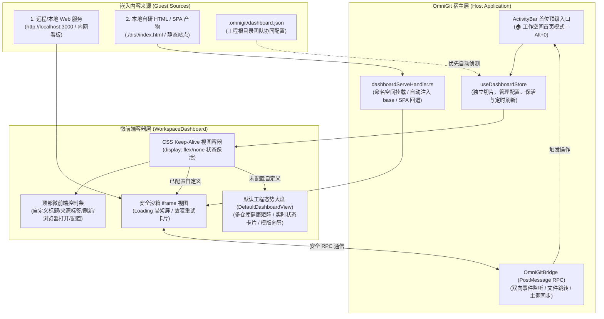
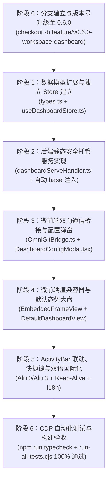

# OmniGit 工作空间自定义研发首页（Workspace Dashboard）深度实施方案 (v0.6.0)

> **版本定位与功能愿景**：
> - **目标版本**：升级至 **`v0.6.0`**（里程碑大版本）；
> - **分支策略**：基于当前 `main` 分支检出独立特性分支 `feature/v0.6.0-workspace-dashboard`；
> - **产品愿景**：将 OmniGit 从纯粹的“代码版本提交工具”升维为“以工程工作空间为核心的一站式研发门户（Developer Workbench Portal）”，允许开发者或团队为每个工作空间嵌入自己开发的专属首页（支持本地 HTML/SPA 构建产物或远程 Web URL），提供开箱即用的工程健康态势大盘，并通过标准微前端 RPC 桥接与宿主深度联动。

---

## 一、核心需求本质与架构设计共识 (Core Philosophy & Decisions)

### 1. 为什么“写死的首页”无法满足异构团队？
在现代研发场景中，每个工程或技术团队的核心关注点天差地别：
- **前端/全栈团队**：关注本地实时预览端口（`localhost:3000` / `localhost:5173` / Storybook）、本地 Mock 服务；
- **敏捷项目团队**：关注敏捷看板（Jira、Tapd、飞书项目）、迭代燃尽图、当前 Sprint 任务；
- **技术规范/文档团队**：关注本地文档站点（VitePress、Docusaurus、Swagger/Apifox 接口定义）；
- **CI/CD 与运维**：关注流水线状态（GitLab CI、GitHub Actions、Jenkins 构建大盘）。

**“允许每个人自己开发、自己嵌入”的本质，就是将 OmniGit 打造为一个开放的微前端容器与研发枢纽（Micro-Frontend Host & Developer Portal）**。

### 2. 针对工程架构核查形成的 8 项核心共识与优化落地
1. **架构解耦与文件体量红线防线**：
   - 本地 `workspaceSlice.ts` 已达 1551 行（严禁继续膨胀）。Dashboard 相关的活跃状态、配置弹窗开闭、刷新定时器全部收拢至专属的 `app/src/features/workspace-dashboard/useDashboardStore.ts`；
   - `app/src/server/gitApiHandler.ts` 已达 565 行，静态资源代理服务单独抽离至 `app/src/server/dashboardServeHandler.ts`，主路由仅做 3 行分发；
   - 所有新增与重构的单文件代码严格控制在 **400 行以内**（健康体量标准）。
2. **SPA 单页应用静态资源相对寻址与路由隔离**：
   - 彻底废除 `?path=` 查询参数代理方案（无法传递至子资源请求，导致 404）；
   - 采用挂载路由：`http://127.0.0.1:5345/api/workspace/dashboard-serve/:workspaceId/*`；
   - 后端下发 HTML 时**自动注入 `<base href="/api/workspace/dashboard-serve/${workspaceId}/">`**，无论 SPA 打包产物使用相对路径（`./assets/`）还是根路径（`/assets/`），均精准定位至该工作空间的沙箱目录；
   - 提供 SPA History 路由回退（未匹配文件回退返回 `index.html`）。
3. **微前端双向通信桥接（`OmniGitBridge`）**：
   - 开放安全 `postMessage` 协议，使嵌入的前端具有真正的 IDE 宿主能力：
     - `omnigit.navigateTo('git' | 'explorer' | 'services')`：从自研首页直接跳转到提交面板或微服务；
     - `omnigit.openFile(filePath, line)`：直接在 OmniGit 内置代码编辑器中打开并定位文件；
     - `omnigit.syncAll()`：一键触发工作空间多仓库拉取与同步；
     - `omnigit.getWorkspaceInfo()`：获取当前工作空间名称、根目录、多仓库列表与分支；
   - 宿主自适应广播：当 OmniGit 切换暗黑/明亮主题时，向 iframe 广播主题消息，让嵌入页面自适应界面风格。
4. **CSS Keep-Alive 视图保活**：
   - 切换 Tab 时不销毁 iframe DOM，采用 CSS `display: flex/none` 保活，保留自研页面的交互状态、表单内容与滚动位置，杜绝频繁重载白屏。
5. **快捷键体系守正出奇**：
   - 首页：`Alt + 0`（Home）；
   - Git 提交：`Alt + 1`（保持原有肌肉记忆）；
   - 源码资源管理器：`Alt + 2`（保持原有习惯）；
   - 微服务控制台：`Alt + 3`（补齐原有缺口）；
   - 内置终端：`Ctrl/Cmd + ` `。
6. **团队协同与配置持久化**：
   - 双层配置协同：优先加载工作空间根目录下的 `.omnigit/dashboard.json`。若存在，团队成员通过 Git 拉取代码后自动开箱生效；
   - 本地轻量持久化：若未检出团队配置文件，保存在当前工作空间记录（`WorkspaceGroupItem.dashboard`）中，同步至本地持久化存储。
7. **默认工程态势大盘（Default Fallback）**：
   - 当尚未配置自定义页面时，呈现 IntelliJ 风格的聚合态势矩阵（多仓库分支胶囊、未提交改动数、未拉取/未推送指示器 `↙ ↗`、微服务运行状态条、一键跳转 Git 操作等），并附带打造自研首页的向导模版（一键填入本地端口、dist 产物等）。
8. **自动化测试与端到端质检验收**：
   - 将 Dashboard 的 API SLA（响应延迟、`<base>` 注入校验、安全越界拦截）接入 `test/scripts/api-e2e-test.cjs`；
   - 将 Chrome CDP 无头浏览器自动化导航与渲染测试接入 `test/scripts/cdp-browser-test.cjs`，输出标准报告截图 `test/reports/09_workspace_dashboard.png`。

---

## 二、系统架构与数据流图 (System Architecture)



---

## 三、微前端通信协议规范 (OmniGitBridge Protocol)

### 1. 嵌入页面 -> 宿主 (Guest to Host)
```typescript
// 页面内部调用示例：
window.parent.postMessage({
  source: 'omnigit-guest',
  type: 'omnigit:navigate',
  payload: { mode: 'git' } // 'git' | 'explorer' | 'services'
}, '*');

// 快速打开文件并在 Monaco 编辑器中定位行号
window.parent.postMessage({
  source: 'omnigit-guest',
  type: 'omnigit:open-file',
  payload: { filePath: 'src/App.tsx', line: 42 }
}, '*');

// 触发工作空间全量 Git 状态刷新
window.parent.postMessage({
  source: 'omnigit-guest',
  type: 'omnigit:sync-all'
}, '*');
```

### 2. 宿主 -> 嵌入页面 (Host to Guest)
```typescript
// 宿主向 iframe 广播环境与状态（如切换主题、切换分支）
iframe.contentWindow.postMessage({
  source: 'omnigit-host',
  type: 'omnigit:state-update',
  payload: {
    theme: 'darcula', // 'darcula' | 'idea-light' | 'github-dark' | 'nord-frost'
    workspace: {
      id: 'ws_xxx',
      name: 'OmniGit',
      rootPath: 'D:/projects/OmniGit',
      repos: [{ name: 'app', branch: 'main', uncommittedCount: 2 }]
    }
  }
}, '*');
```

---

## 四、实施阶段与文件级任务细化 (Implementation Milestones)



### 阶段 0：分支建立与版本号升级至 0.6.0（首要前置红线）
1. **创建独立特性分支**：
   - 命令行：`git checkout -b feature/v0.6.0-workspace-dashboard`；
   - 确保工作区干净，所有新功能开发与测试均在此分支进行。
2. **全工程版本号升级为 `0.6.0`**：
   - `app/package.json`：`"version": "0.6.0"`
   - `app/src/constants/version.ts`：`export const APP_VERSION = '0.6.0';`
   - `scripts/installer.nsi`：`!define PRODUCT_VERSION "0.6.0"`
   - `scripts/build-installer.cjs`：默认版本修改为 `'0.6.0'`
   - `scripts/build_desktop.bat` & `scripts/publish_release.bat`：默认版本统一对齐为 `'0.6.0'`。

### 阶段 1：数据模型扩展与独立 Store 建立
1. 在 `app/src/store/types.ts` 中新增数据类型：
   ```typescript
   export interface WorkspaceDashboardConfig {
     enabled: boolean;                      // 是否启用自定义自研首页
     type: 'url' | 'file';                  // 嵌入类型：Web 链接 或 本地文件
     url?: string;                          // Web 链接
     filePath?: string;                     // 本地 HTML 路径（支持绝对路径或相对工作空间路径）
     title?: string;                        // 自定义页面显示标题
     openMode?: 'embedded' | 'external';    // 嵌入渲染 或 外部默认浏览器
     autoReload?: boolean;                  // 是否启用定时刷新
     reloadIntervalSeconds?: number;        // 定时刷新周期（默认 60 秒）
   }
   ```
2. 在 `WorkspaceGroupItem` 中增加可选字段：`dashboard?: WorkspaceDashboardConfig`。
3. 在 `app/src/store/useWorkbenchStore.ts` 中扩展：
   `export type WorkbenchMode = 'dashboard' | 'git' | 'explorer' | 'services';`
4. 新建 `app/src/features/workspace-dashboard/types.ts`：定义微前端消息格式与弹窗状态。
5. 新建 `app/src/features/workspace-dashboard/useDashboardStore.ts`（控制在 250 行内）：
   - 管理当前活跃工作空间的 Dashboard 配置；
   - 自动侦测与加载 `.omnigit/dashboard.json`；
   - 管理配置弹窗开闭（`isConfigModalOpen`）与手动/定时刷新触发信号（`refreshKey`）。

### 阶段 2：后端本地安全静态托管服务实现
1. 新建 `app/src/server/dashboardServeHandler.ts`（控制在 250 行内）：
   - 拦截路径：`/api/workspace/dashboard-serve/:workspaceId/*`；
   - **安全路径沙箱**：解析目标文件物理路径，验证必须位于对应工作空间根目录或用户指定的文件目录内，拒绝跨目录穿透攻击；
   - **动态注入 `<base>` 标签**：当下发 `.html` 格式文件时，正则匹配并在 `<head>` 首部注入 `<base href="/api/workspace/dashboard-serve/${workspaceId}/">`；
   - **全面 MIME 映射**：涵盖 `.html`, `.js`, `.mjs`, `.css`, `.json`, `.svg`, `.png`, `.jpg`, `.webp`, `.ico`, `.woff`, `.woff2`, `.ttf`, `.wasm` 等；
   - **SPA History Fallback**：若请求的静态文件不存在且无后缀，自动回退返回 `index.html`。
2. 在 `app/src/server/gitApiHandler.ts` 中添加极简委托（3行代码）：
   - 若 `url.startsWith('/api/workspace/dashboard-serve')`，调用 `handleDashboardServeRequest(req, res)` 并返回 `true`。

### 阶段 3：微前端双向通信桥接与配置弹窗
1. 新建 `app/src/features/workspace-dashboard/OmniGitBridge.ts`（控制在 120 行内）：
   - 封装安全的 `window.addEventListener('message')` 监听器；
   - 响应 `omnigit:navigate`、`omnigit:open-file`、`omnigit:sync-all`、`omnigit:get-workspace-info`；
   - 提供 `sendToGuest(iframeWindow, message)` 工具函数。
2. 编写 `app/src/features/workspace-dashboard/DashboardConfigModal.tsx`（控制在 350 行内）：
   - 支持“Web 链接”与“本地自研 HTML 文件”双模式切换；
   - 本地文件模式调用原生 `electronAPI.selectFile`（支持过滤 `.html`、`.htm`）；
   - 支持自定义标题、自动刷新开关及频率设置；
   - 专属导出选项：“保存为团队工程配置（写入 `.omnigit/dashboard.json`）”与“仅保存在本机”。

### 阶段 4：微前端渲染容器与默认态势大盘
1. 编写 `app/src/features/workspace-dashboard/EmbeddedFrameView.tsx`（控制在 250 行内）：
   - 顶部提供沉浸式工具栏：自定义标题、来源徽章（URL / Local HTML）、重新加载 🔄、在系统浏览器打开 🔗、首页设置 ⚙️；
   - 中间主体采用安全沙箱 iframe（`sandbox="allow-scripts allow-same-origin allow-forms allow-popups"`）；
   - 具备 Loading 骨架屏与失败友好降级页（包含排查建议与一键重试）。
2. 编写 `app/src/features/workspace-dashboard/DefaultDashboardView.tsx`（控制在 350 行内）：
   - 顶部概览条：工作空间名称、根目录、多仓库数量、微服务运行数；
   - 多仓库健康矩阵卡片：当前分支、未推送/未拉取计数 `↙ ↗`、未提交文件数、一键直达 Git 提交工作台；
   - “打造专属自研首页”模板推荐卡片（快速填入本地开发端口 `localhost:3000`、VitePress 文档产物、SPA 构建产物等）；
   - 快捷动作条：跳转提交面板（`Alt+1`）、资源管理器（`Alt+2`）、服务控制台（`Alt+3`）、新建终端。
3. 封装组合为 `app/src/features/workspace-dashboard/WorkspaceDashboard.tsx`（控制在 150 行内）。

### 阶段 5：ActivityBar 联动、快捷键与双语国际化
1. 更新 `app/src/features/activity-bar/ActivityBar.tsx`：
   - 首位新增 `LayoutDashboard` 图标（`Alt+0` 提示），高亮指示与徽章提示；
2. 更新 `app/src/App.tsx`：
   - 绑定快捷键：`Alt+0` 切换到 Dashboard，`Alt+3` 切换到 Services；保留原有 `Alt+1`（Git）与 `Alt+2`（Explorer）；
   - 采用 CSS Keep-Alive 容器包裹 `<WorkspaceDashboard />`，切换 Tab 时使用 `display: flex/none` 避免 iframe 重新加载。
3. 严格遵循双语规范：
   - 在 `app/src/locales/types.ts` 中定义完整的 `dashboard` 字典类型；
   - 在 `app/src/locales/zh-CN.ts` 与 `en-US.ts` 中录入纯正文案，彻底零硬编码。

### 阶段 6：CDP 自动化测试与交付校验闭环
1. 在 `test/scripts/api-e2e-test.cjs` 中新增静态代理 SLA 与 `<base>` 注入测试用例；
2. 在 `test/scripts/cdp-browser-test.cjs` 中新增对 Dashboard 视图与快捷键交互的无头 Chrome 测试，生成 `test/reports/09_workspace_dashboard.png`；
3. 运行严格编译校验：`cd app && npm run typecheck`（必须 0 错误、0 警告）；
4. 运行全量自动化测试：`node test/scripts/run-all-tests.cjs`（必须 100% 通过）。

---

## 五、验证与测试标准 (Verification Strategy)

| 验证场景 | 测试步骤与通过标准 |
| :--- | :--- |
| **分支与版本核查** | 执行 `git branch` 显示在 `feature/v0.6.0-workspace-dashboard`，界面与安装脚本均正确展示 `0.6.0`。 |
| **远程 Web 嵌入测试** | 配置为 `http://localhost:3000` 或外部页面，页面无变形完整渲染，可自由点击交互，顶部刷新与外链跳转正常。 |
| **本地 HTML/SPA 测试** | 选取前端打包构建产物 `dist/index.html`，通过 `dashboard-serve` 本地挂载正常加载，子资源 `.js`/`.css`/图片无 404，无白屏。 |
| **双向 RPC 桥接测试** | 在嵌入页面调用 `postMessage` 请求导航或打开文件，OmniGit 正确响应并跳转至对应工作台/打开对应文件。 |
| **视图保活 Keep-Alive** | 嵌入页面内产生状态（如滚动到底部或输入表单），按 `Alt+1` 切到 Git 提交面板再按 `Alt+0` 切回，iframe 零刷新、状态完整保留。 |
| **快捷键体系核查** | 按 `Alt+0` 进入首页，按 `Alt+1` 进入 Git，按 `Alt+2` 进入资源管理器，按 `Alt+3` 进入服务控制台，流畅无阻。 |
| **团队协同文件测试** | 在工作空间根目录生成 `.omnigit/dashboard.json`，切换或重载工作空间自动识别该配置，无需手动重复设置。 |
| **多语言与暗黑主题核查** | 切换中英双语，首页、配置弹窗、顶部工具栏提示均呈现纯正单语言；切换主题时，iframe 收到主题更新事件。 |
| **自动化测试网核查** | 运行 `node test/scripts/run-all-tests.cjs`，所有测试用例 100% 成功，产出 `test/reports/09_workspace_dashboard.png`。 |
| **构建红线核查** | 控制台运行 `npm run typecheck`，退出码为 0，无任何类型错误或未导入变量。 |
