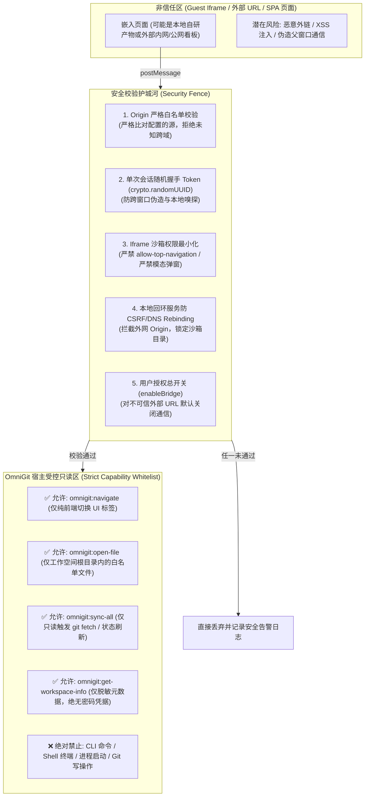
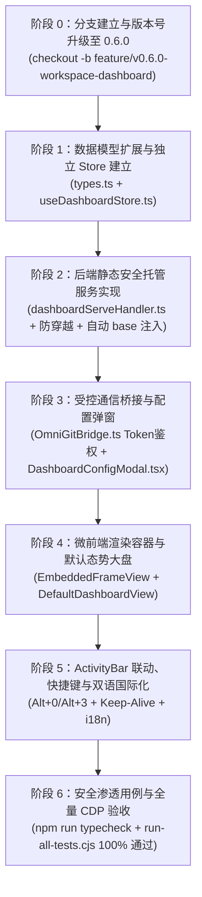

# OmniGit 工作空间自定义研发首页（Workspace Dashboard）深度实施方案 (v0.6.0)

> **版本定位与功能愿景**：
> - **目标版本**：升级至 **`v0.6.0`**（里程碑大版本）；
> - **分支策略**：基于当前 `main` 分支检出独立特性分支 `feature/v0.6.0-workspace-dashboard`；
> - **产品愿景**：将 OmniGit 从纯粹的“代码版本提交工具”升维为“以工程工作空间为核心的一站式研发门户（Developer Workbench Portal）”，允许开发者或团队为每个工作空间嵌入专属自研首页（支持本地 HTML/SPA 构建产物或远程 Web URL），提供开箱即用的工程健康态势大盘，并通过标准微前端 RPC 桥接与宿主深度联动。
> - **最高安全准则（零信任与防 RCE 护城河）**：OmniGit 拥有终端 PTY、原生 Git CLI 及系统进程启动能力，**微前端模块必须实施最高等级的零信任纵深防御**。严禁向嵌入页面暴露任何命令行执行、系统写操作或任意文件越界读取权限，确保外部恶意网页或 XSS 注入无法利用本系统执行本地代码（Anti-RCE）。

---

## 一、第零原则：微前端宿主零信任安全架构与防 RCE 护城河 (Zero-Trust Security & Anti-RCE Architecture)

在桌面应用（Electron + 本地回环服务）中引入第三方/外部页面嵌入与 `postMessage` 通信时，若设计不当极易沦为黑客攻击本地电脑的跳板。为此，本方案建立**六大安全死锁红线（Ironclad Security Redlines）**：



### 1. 绝对零代码/命令执行权 (Zero Code/CLI Execution via Bridge)
- **铁律**：`OmniGitBridge` **坚决不开放任何命令行、终端操作或进程执行接口**！
- 严禁提供任何诸如 `runTerminalCommand`、`executeShell`、`spawnProcess`、`startService`、`gitCommit`、`gitPush`、`gitReset` 等具备写或执行能力的 RPC 接口；
- 所有由桥接发起的操作**仅限于只读纯 UI 导航或只读文件查看**：
  - `omnigit:navigate`：仅在 React 前端内部调用 `setWorkbenchMode('git' | 'explorer' | 'services')` 进行页面标签切换，不触发任何底层命令；
  - `omnigit:open-file`：仅在 Monaco 编辑器以只读/编辑展示文件内容（并且文件路径必须经过严格路径白名单校验，必须在当前工作空间根目录下，严禁访问工作空间外部文件或系统敏感目录）；
  - `omnigit:sync-all`：仅触发静默状态拉取刷新（相当于点击界面刷新按钮），不包含任何破坏性更新或脚本执行；
  - `omnigit:get-workspace-info`：仅返回工作空间名称、当前分支、各仓库相对路径等脱敏基础元数据；**严禁返回系统环境变量、Git 凭据、SSH Key 或本地绝对敏感路径**。

### 2. 单次会话随机握手 Token (Cryptographic Session Handshake Token)
- 为嵌入页面生成单次会话高强度随机 Token（`crypto.randomUUID()`），挂载在 Iframe 的 URL Hash 中（如 `http://127.0.0.1:5345/...#omnigitToken=...`，Hash 仅存在于客户端，不会随 HTTP 请求泄漏至服务端日志）；
- 嵌入页面通过 Bridge 发起的所有 `postMessage` 必须携带该 `token`；
- 宿主端收到消息时，除校验 `event.origin` 与 `event.source === iframeRef.contentWindow` 外，**必须强校验 `event.data.token === currentSessionToken`**；
- 任何来自未授权窗口、未知 Origin、第三方页面或无有效 Token 的消息直接静默丢弃并记录安全告警日志，彻底免疫跨窗口伪造与恶意页面探针。

### 3. Iframe 沙箱权限最小化与隔离 (Sandbox Hardening & Anti-Phishing)
- `sandbox="allow-scripts allow-forms allow-popups allow-same-origin"`；
- **严格禁止**赋予以下高危权限：
  - **禁止** `allow-top-navigation` / `allow-top-navigation-by-user-activation`（严禁嵌入的页面通过 `top.location` 重定向或篡改 OmniGit 主窗口界面，彻底杜绝钓鱼欺诈）；
  - **禁止** `allow-modals`（禁止弹出伪造系统 alert/confirm/prompt 窗口误导用户）；
  - **禁止** `allow-pointer-lock`；
  - **禁止** `allow-downloads-without-user-activation`；
- Electron 主进程防线：`win.webContents.setWindowOpenHandler` 全局拦截，所有 `window.open` 只能交由操作系统默认浏览器外链打开，禁止在主进程内创建未受控渲染窗口。

### 4. 回环静态托管服务防跨站盗链与防目录穿越 (Loopback Anti-CSRF & Directory Traversal Protection)
- `dashboardServeHandler.ts` 服务于 `http://127.0.0.1:5345`：
  - **严格检验 Referer / Origin**：若请求带有 `Origin` 或 `Referer` 标头，且来自外部公网域名（如浏览器中访问了 `evil-hacker.com` 试图隐蔽探测 `http://127.0.0.1:5345/api/...`），一律直接返回 `403 Forbidden` 并阻断，彻底防御本地端口 CSRF/DNS Rebinding 攻击；
  - **绝对路径白名单沙箱**：无论传入的相对路径如何使用 `../`、`..%2F` 或 URL 编码穿透，使用 `path.resolve` 计算出的绝对路径**必须以当前工作空间允许的根目录为前缀**（`resolvedPath.startsWith(allowedWorkspaceRoot)`）；
  - **拦截敏感系统路径**：禁止访问任何包含 `.git/config`（防止泄露凭据 token）、`.env`、Windows 系统目录、用户私钥（`.ssh`、`id_rsa`）等敏感文件；
  - **严格 MIME 隔离**：仅支持静态资源白名单格式，并添加 `X-Content-Type-Options: nosniff` 标头。

### 5. 用户明确授权与可插拔总开关 (User Explicit Authorization & Kill Switch)
- 在 `DashboardConfigModal.tsx` 中增设：
  - “开启微前端宿主通信联动（`enableBridge`）”明确开关：
    - 对于本地自研 HTML 产物和 `localhost` 本地服务，默认开启；
    - 对于外部未知远程 Web URL，**默认关闭**，并展示醒目的黄色安全警示条：“⚠️ 嵌入未知外部网络链接时，建议关闭宿主通信桥接，以确保绝对沙箱隔离”；
  - 用户关闭后，宿主完全不向该 iframe 注册或响应任何 `postMessage` 事件，完全降级为纯粹的展示型静态只读 iframe。

---

## 二、架构设计共识与核心优化落地 (Architecture Decisions)

### 1. 架构解耦与文件体量红线防线
- 本地 `workspaceSlice.ts` 已达 1551 行（严禁继续膨胀）。Dashboard 相关的活跃状态、配置弹窗开闭、刷新定时器全部收拢至专属的 `app/src/features/workspace-dashboard/useDashboardStore.ts`；
- `app/src/server/gitApiHandler.ts` 已达 565 行，静态资源代理服务单独抽离至 `app/src/server/dashboardServeHandler.ts`，主路由仅做 3 行分发；
- 所有新增与重构的单文件代码严格控制在 **400 行以内**（健康体量标准）。

### 2. SPA 单页应用静态资源相对寻址与路由隔离
- 采用挂载路由：`http://127.0.0.1:5345/api/workspace/dashboard-serve/:workspaceId/*`；
- 后端下发 HTML 时**自动注入 `<base href="/api/workspace/dashboard-serve/${workspaceId}/">`**，无论 SPA 打包产物使用相对路径（`./assets/`）还是根路径（`/assets/`），均精准定位至该工作空间的沙箱目录；
- 提供 SPA History 路由回退（未匹配文件回退返回 `index.html`）。

### 3. CSS Keep-Alive 视图保活
- 切换 Tab 时不销毁 iframe DOM，采用 CSS `display: flex/none` 保活，保留自研页面的交互状态、表单内容与滚动位置，杜绝频繁重载白屏。

### 4. 快捷键体系守正出奇
- 首页：`Alt + 0`（Home）；
- Git 提交：`Alt + 1`（保持原有肌肉记忆）；
- 源码资源管理器：`Alt + 2`（保持原有习惯）；
- 微服务控制台：`Alt + 3`（补齐原有缺口）；
- 内置终端：`Ctrl/Cmd + ` `。

### 5. 团队协同与配置持久化
- 双层配置协同：优先加载工作空间根目录下的 `.omnigit/dashboard.json`。若存在，团队成员通过 Git 拉取代码后自动开箱生效；
- 本地轻量持久化：若未检出团队配置文件，保存在当前工作空间记录（`WorkspaceGroupItem.dashboard`）中，同步至本地持久化存储。

### 6. 默认工程态势大盘（Default Fallback）
- 当尚未配置自定义页面时，呈现 IntelliJ 风格的聚合态势矩阵（多仓库分支胶囊、未提交改动数、未拉取/未推送指示器 `↙ ↗`、微服务运行状态条、一键跳转 Git 操作等），并附带打造自研首页的向导模版（一键填入本地端口、dist 产物等）。

---

## 三、微前端受控通信协议规范 (OmniGitBridge Protocol)

### 1. 嵌入页面 -> 宿主 (Guest to Host)
```typescript
// 页面内部调用示例（必须附带握手 Token）：
window.parent.postMessage({
  source: 'omnigit-guest',
  token: window.location.hash.replace('#omnigitToken=', ''), // 单次会话鉴权令牌
  type: 'omnigit:navigate',
  payload: { mode: 'git' } // 仅限纯前端界面切换：'git' | 'explorer' | 'services'
}, '*');

// 快速打开当前工作空间内的白名单代码文件并在 Monaco 编辑器中定位行号
window.parent.postMessage({
  source: 'omnigit-guest',
  token: window.location.hash.replace('#omnigitToken=', ''),
  type: 'omnigit:open-file',
  payload: { filePath: 'src/App.tsx', line: 42 } // 宿主将校验必须在当前 workspaceRoot 内
}, '*');

// 触发工作空间全量 Git 状态刷新（纯只读拉取与状态比对）
window.parent.postMessage({
  source: 'omnigit-guest',
  token: window.location.hash.replace('#omnigitToken=', ''),
  type: 'omnigit:sync-all'
}, '*');
```

### 2. 宿主 -> 嵌入页面 (Host to Guest)
```typescript
// 宿主向 iframe 广播环境与状态（如切换主题、切换分支）
iframe.contentWindow.postMessage({
  source: 'omnigit-host',
  type: 'omnigit:state-update',
  payload: {
    theme: 'darcula', // 'darcula' | 'idea-light' | 'github-dark' | 'nord-frost'
    workspace: {
      id: 'ws_xxx',
      name: 'OmniGit',
      repos: [{ name: 'app', branch: 'main', uncommittedCount: 2 }] // 脱敏元数据
    }
  }
}, '*');
```

---

## 四、实施阶段与文件级任务细化 (Implementation Milestones)



### 阶段 0：分支建立与版本号升级至 0.6.0（首要前置红线）
1. **创建独立特性分支**：
   - 命令行：`git checkout -b feature/v0.6.0-workspace-dashboard`；
   - 确保工作区干净，所有新功能开发与测试均在此分支进行。
2. **全工程版本号升级为 `0.6.0`**：
   - `app/package.json`：`"version": "0.6.0"`
   - `app/src/constants/version.ts`：`export const APP_VERSION = '0.6.0';`
   - `scripts/installer.nsi`：`!define PRODUCT_VERSION "0.6.0"`
   - `scripts/build-installer.cjs`：默认版本修改为 `'0.6.0'`
   - `scripts/build_desktop.bat` & `scripts/publish_release.bat`：默认版本统一对齐为 `'0.6.0'`。

### 阶段 1：数据模型扩展与独立 Store 建立
1. 在 `app/src/store/types.ts` 中新增数据类型：
   ```typescript
   export interface WorkspaceDashboardConfig {
     enabled: boolean;                      // 是否启用自定义自研首页
     type: 'url' | 'file';                  // 嵌入类型：Web 链接 或 本地文件
     url?: string;                          // Web 链接
     filePath?: string;                     // 本地 HTML 路径（支持绝对路径或相对工作空间路径）
     title?: string;                        // 自定义页面显示标题
     openMode?: 'embedded' | 'external';    // 嵌入渲染 或 外部默认浏览器
     autoReload?: boolean;                  // 是否启用定时刷新
     reloadIntervalSeconds?: number;        // 定时刷新周期（默认 60 秒）
     enableBridge?: boolean;                // 【安全配置】是否允许启用宿主微前端桥接联动（外部 URL 默认 false）
   }
   ```
2. 在 `WorkspaceGroupItem` 中增加可选字段：`dashboard?: WorkspaceDashboardConfig`。
3. 在 `app/src/store/useWorkbenchStore.ts` 中扩展：
   `export type WorkbenchMode = 'dashboard' | 'git' | 'explorer' | 'services';`
4. 新建 `app/src/features/workspace-dashboard/types.ts`：定义微前端消息格式、安全 Token 与弹窗状态。
5. 新建 `app/src/features/workspace-dashboard/useDashboardStore.ts`（控制在 250 行内）：
   - 管理当前活跃工作空间的 Dashboard 配置；
   - 自动侦测与加载 `.omnigit/dashboard.json`；
   - 管理配置弹窗开闭（`isConfigModalOpen`）与生成每个 Iframe 会话的高强度随机 `sessionToken`。

### 阶段 2：后端本地安全静态托管服务实现
1. 新建 `app/src/server/dashboardServeHandler.ts`（控制在 250 行内）：
   - 拦截路径：`/api/workspace/dashboard-serve/:workspaceId/*`；
   - **防 CSRF / 盗链拦截**：校验请求 Header，凡带有外部公网 `Origin` 或 `Referer` 的嗅探请求一律阻断（返回 403 Forbidden）；
   - **安全路径沙箱**：解析物理路径并执行 `path.resolve`，验证必须位于对应工作空间根目录内，绝对禁止跨盘符穿透与读取系统敏感目录；
   - **动态注入 `<base>` 标签**：当下发 `.html` 格式文件时，正则匹配并在 `<head>` 首部注入 `<base href="/api/workspace/dashboard-serve/${workspaceId}/">`；
   - **全面 MIME 映射**：涵盖 `.html`, `.js`, `.mjs`, `.css`, `.json`, `.svg`, `.png`, `.jpg`, `.webp`, `.ico`, `.woff`, `.woff2`, `.ttf`, `.wasm` 等，添加 `X-Content-Type-Options: nosniff` 响应头；
   - **SPA History Fallback**：若请求的静态文件不存在且无扩展名后缀，自动回退返回 `index.html`。
2. 在 `app/src/server/gitApiHandler.ts` 中添加极简委托（3行代码）：
   - 若 `url.startsWith('/api/workspace/dashboard-serve')`，调用 `handleDashboardServeRequest(req, res)` 并返回 `true`。

### 阶段 3：受控通信桥接与配置弹窗
1. 新建 `app/src/features/workspace-dashboard/OmniGitBridge.ts`（控制在 150 行内）：
   - 封装安全的 `window.addEventListener('message')` 监听器；
   - **双重身份验真**：
     1. 强校验 `event.origin` 必须匹配配置的源（本地页面需匹配 `http://127.0.0.1:5345`）；
     2. 强校验 `event.source === iframeRef.contentWindow`；
     3. 强校验 `event.data.token === activeSessionToken`；
   - **白名单能力分发**：
     - `omnigit:navigate`：仅调用 `setWorkbenchMode` 纯前端界面切换；
     - `omnigit:open-file`：严格校验路径必须在当前 workspaceRoot 内后调用打开编辑器；
     - `omnigit:sync-all`：仅触发静默同步；
     - `omnigit:get-workspace-info`：仅下发脱敏后的基础信息。
   - 提供 `sendToGuest(iframeWindow, message)` 工具函数。
2. 编写 `app/src/features/workspace-dashboard/DashboardConfigModal.tsx`（控制在 350 行内）：
   - 支持“Web 链接”与“本地自研 HTML 文件”双模式切换；
   - 本地文件模式调用原生 `electronAPI.selectFile`（支持过滤 `.html`、`.htm`）；
   - 提供“开启微前端通信（`enableBridge`）”安全勾选项与警示说明；
   - 专属导出选项：“保存为团队工程配置（写入 `.omnigit/dashboard.json`）”与“仅保存在本机”。

### 阶段 4：微前端渲染容器与默认态势大盘
1. 编写 `app/src/features/workspace-dashboard/EmbeddedFrameView.tsx`（控制在 250 行内）：
   - 顶部提供沉浸式工具栏：自定义标题、来源徽章（URL / Local HTML）、重新加载 🔄、在系统浏览器打开 🔗、首页设置 ⚙️；
   - 中间主体采用安全沙箱 iframe（`sandbox="allow-scripts allow-same-origin allow-forms allow-popups"`，**坚决不配** `allow-top-navigation` 与 `allow-modals`）；
   - 携带 `#omnigitToken=...` 会话 Hash 挂载，具备 Loading 骨架屏与失败友好降级页。
2. 编写 `app/src/features/workspace-dashboard/DefaultDashboardView.tsx`（控制在 350 行内）：
   - 顶部概览条：工作空间名称、根目录、多仓库数量、微服务运行数；
   - 多仓库健康矩阵卡片：当前分支、未推送/未拉取计数 `↙ ↗`、未提交文件数、一键直达 Git 提交工作台；
   - “打造专属自研首页”模板推荐卡片（快速填入本地开发端口 `localhost:3000`、VitePress 文档产物、SPA 构建产物等）；
   - 快捷动作条：跳转提交面板（`Alt+1`）、资源管理器（`Alt+2`）、服务控制台（`Alt+3`）、新建终端。
3. 封装组合为 `app/src/features/workspace-dashboard/WorkspaceDashboard.tsx`（控制在 150 行内）。

### 阶段 5：ActivityBar 联动、快捷键与双语国际化
1. 更新 `app/src/features/activity-bar/ActivityBar.tsx`：
   - 首位新增 `LayoutDashboard` 图标（`Alt+0` 提示），高亮指示与徽章提示；
2. 更新 `app/src/App.tsx`：
   - 绑定快捷键：`Alt+0` 切换到 Dashboard，`Alt+3` 切换到 Services；保留原有 `Alt+1`（Git）与 `Alt+2`（Explorer）；
   - 采用 CSS Keep-Alive 容器包裹 `<WorkspaceDashboard />`，切换 Tab 时使用 `display: flex/none` 避免 iframe 重新加载。
3. 严格遵循双语规范：
   - 在 `app/src/locales/types.ts` 中定义完整的 `dashboard` 字典类型（含安全设置相关提示文案）；
   - 在 `app/src/locales/zh-CN.ts` 与 `en-US.ts` 中录入纯正文案，彻底零硬编码。

### 阶段 6：安全测试网、CDP 自动化测试与交付验收
1. 在 `test/scripts/api-e2e-test.cjs` 中新增静态代理 SLA、`<base>` 注入测试，以及**安全越界防御测试用例**（模拟跨域探测返回 403，模拟 `../../Windows` 路径穿越返回拦截）；
2. 在 `test/scripts/cdp-browser-test.cjs` 中新增对 Dashboard 视图、快捷键交互与沙箱安全性的无头 Chrome 测试，生成 `test/reports/09_workspace_dashboard.png`；
3. 运行严格编译校验：`cd app && npm run typecheck`（必须 0 错误、0 警告）；
4. 运行全量自动化测试：`node test/scripts/run-all-tests.cjs`（必须 100% 通过）。

---

## 五、验证与安全测试标准 (Verification & Security SLA)

| 验证场景 | 测试步骤与安全通过标准 |
| :--- | :--- |
| **防命令执行红线核查** | 无论从 iframe 传入何种恶意的 payload（如包含 `rm -rf`, `calc.exe`, `curl`, `git push`），宿主绝对不解析、不执行任何命令行，控制台打印安全阻断警告。 |
| **防未授权 PostMessage 伪造** | 模拟外部非同源窗口或无合法 `token` 的消息，OmniGitBridge 100% 拒绝并静默丢弃，绝不触发任何动作。 |
| **防本地端口 CSRF 嗅探** | 伪造带外部 `Origin: https://attacker.com` 的请求探测 `/api/workspace/dashboard-serve`，服务端坚决返回 `403 Forbidden`。 |
| **防跨盘符与目录穿越攻击** | 传入包含 `../../Windows/System32` 或跨盘符的恶意路径，服务严格判断 `startsWith(workspaceRoot)`，坚决拒绝读取。 |
| **防钓鱼顶层跳转与模态弹窗** | iframe 页面内执行 `window.top.location = '...'` 或 `alert('...')`，浏览器原生沙箱机制直接阻断，宿主窗口不受任何干扰。 |
| **远程 Web 嵌入测试** | 配置为 `http://localhost:3000` 或外部页面，页面无变形完整渲染，可自由点击交互，顶部刷新与外链跳转正常。 |
| **本地 HTML/SPA 测试** | 选取前端打包构建产物 `dist/index.html`，通过 `dashboard-serve` 本地挂载正常加载，子资源 `.js`/`.css`/图片无 404，无白屏。 |
| **视图保活 Keep-Alive** | 嵌入页面内产生状态，按 `Alt+1` 切到 Git 提交面板再按 `Alt+0` 切回，iframe 零刷新、状态完整保留。 |
| **快捷键体系核查** | 按 `Alt+0` 进入首页，按 `Alt+1` 进入 Git，按 `Alt+2` 进入资源管理器，按 `Alt+3` 进入服务控制台，流畅无阻。 |
| **团队协同文件测试** | 在工作空间根目录生成 `.omnigit/dashboard.json`，切换或重载工作空间自动识别该配置，无需手动重复设置。 |
| **自动化测试网核查** | 运行 `node test/scripts/run-all-tests.cjs`，所有测试用例（含安全防御测试）100% 成功，产出 `test/reports/09_workspace_dashboard.png`。 |
| **构建红线核查** | 控制台运行 `npm run typecheck`，退出码为 0，无任何类型错误或未导入变量。 |
